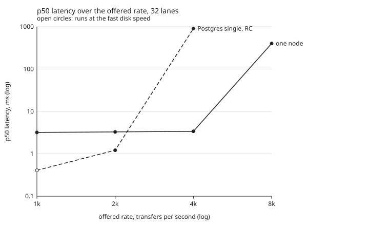
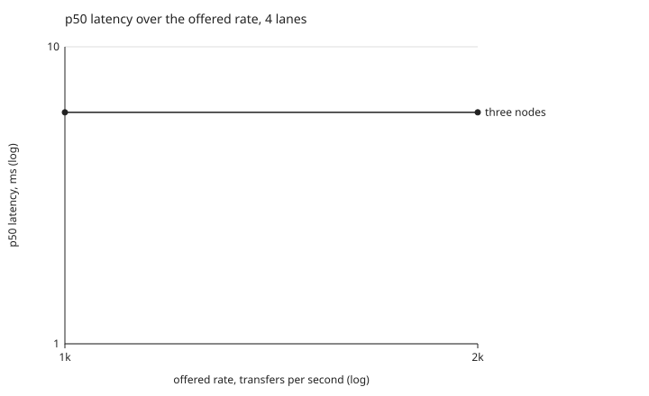
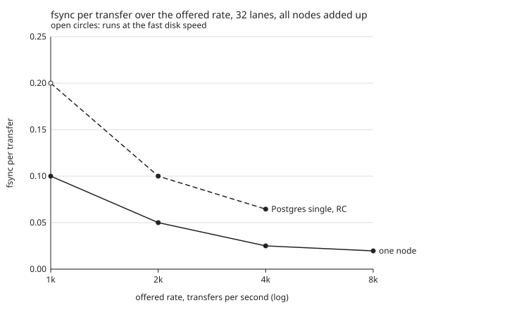

# Benchmark results

Generated by `bench report` from the files in `raw/`; the same files give the same bytes. Change the raw files, not this file: `bench check` compares it with what the raw files give.

Each figure is the median over the counted runs of its row, with the smallest and the largest value in brackets; "runs" says how many runs were counted out of how many were made. A run counts when it is valid and ran at the disk speed of its row. A row shows the slow disk speed when any of its valid runs reached it, otherwise the fast one, marked as such. Within a run only the valid seconds of its disk speed count. Latency is counted from the moment a transfer was scheduled, not from the moment it was sent. "flushes" is a latency divided by the mean flush time of the disk in the same run. p99.9 is listed for completeness and is not compared. "seconds" counts the window seconds of the counted runs that entered the figures, out of all their window seconds, with the highest p99 of a second that was left out. "target cpu" is the CPU time of the target processes divided by the hardware threads they were given, the mean over the window. "fsync per transfer, all nodes" adds up the fsyncs of every node of a cluster and divides them by the confirmed transfers.

## Stages (m1)

How many transfers per second does one node hold, how many a cluster of three nodes, and how does the wait grow with the load? Each stage offers a fixed rate for a fixed window. A stage is held when at the end of its window fewer arrivals are open than fall due in one second; otherwise it is saturated. The last held stage comes from the raster of stages, the throughput under overload is measured in the first saturated stage of each pass. Where the load generator and not the target was the limit, the table says "at least".

| target | lanes | load | passes | last held stage | throughput under overload | runs | limit | agreement |
|---|---|---|---|---|---|---|---|---|
| one node | 32 | uniform-10k | 2 | 4,000 (4,000–4,000) | 5,100 (5,000–5,200) | 2 of 2 | target | agreed |
| three nodes | 4 | uniform-10k | 2 | at least 1,000 (1,000–1,000) | at least 1,500 (1,500–1,500) | 2 of 2 | generator | at least: the generator was the limit |
| Postgres, one transaction per transfer, read committed | 32 | uniform-10k | 1 | 2,000 | 3,100 | 1 of 1 | target | undecided: no pair on an equally fast disk in 1 runs |

Commit testdata; run on 2000-01-01; machine: test CPU, 16 threads, 16.0 GiB RAM, test disk (nvme0n1, ext4 rw,relatime), kernel test kernel, governor powersave, turbo on, power mains; disk speed: slow, mean flush 1.40 (1.40–1.40) ms; fast, mean flush 0.220 ms.

A second counts as fast by the mean time of its flushes, and fast flushes come about seven times as often as slow ones: a fast second can have spent up to about two thirds of its time in slow flushes, a slow second at most about a tenth in fast ones.

The curves show the medians of the tables below; p99 is only in the tables.

### one node, 32 lanes, uniform-10k

| rate | held | speed | flush ms | runs | seconds | p50 ms | p50 flushes | p99 ms | p99.9 ms | throughput/s | target cpu | fsync per transfer, all nodes | transfers per request | retries per transfer | agreement |
|---|---|---|---|---|---|---|---|---|---|---|---|---|---|---|---|
| 1,000 | held | slow | 1.40 (1.40–1.40) | 2 of 2 | 6 of 6 | 3.20 (3.14–3.26) | 2.3 (2.2–2.3) | 9.60 (9.47–9.73) | 9.60 (9.47–9.73) | 1,000 (1,000–1,000) | 10.0% (10.0%–10.0%) | 0.100 (0.100–0.100) | 4.0 (4.0–4.0) | 0.000 (0.000–0.000) | agreed |
| 2,000 | held | slow | 1.40 (1.40–1.40) | 2 of 2 | 6 of 6 | 3.30 (3.26–3.33) | 2.4 (2.3–2.4) | 9.86 (9.73–9.98) | 9.86 (9.73–9.98) | 2,000 (2,000–2,000) | 10.0% (10.0%–10.0%) | 0.050 (0.050–0.050) | 4.0 (4.0–4.0) | 0.000 (0.000–0.000) | agreed |
| 4,000 | held | slow | 1.40 (1.40–1.40) | 2 of 3 | 6 of 6 | 3.39 (3.33–3.46) | 2.4 (2.4–2.5) | 10.1 (9.98–10.2) | 10.1 (9.98–10.2) | 4,000 (4,000–4,000) | 10.0% (10.0%–10.0%) | 0.025 (0.025–0.025) | 4.0 (4.0–4.0) | 0.000 (0.000–0.000) | agreed |
| 8,000 | saturated at 8,000 | slow | 1.40 (1.40–1.40) | 2 of 2 | 6 of 6 | 401 (401–401) | 286.7 (286.7–286.7) | 1,212 (1,212–1,212) | 1,212 (1,212–1,212) | 5,100 (5,000–5,200) | 10.0% (10.0%–10.0%) | 0.020 (0.019–0.020) | 4.0 (4.0–4.0) | 0.000 (0.000–0.000) | agreed |

Commit testdata; run on 2000-01-01; machine: test CPU, 16 threads, 16.0 GiB RAM, test disk (nvme0n1, ext4 rw,relatime), kernel test kernel, governor powersave, turbo on, power mains; disk speed: slow, mean flush 1.40 (1.40–1.40) ms.

### three nodes, 4 lanes, uniform-10k

| rate | held | speed | flush ms | runs | seconds | p50 ms | p50 flushes | p99 ms | p99.9 ms | throughput/s | target cpu | fsync per transfer, all nodes | transfers per request | retries per transfer | agreement |
|---|---|---|---|---|---|---|---|---|---|---|---|---|---|---|---|
| 1,000 | held | slow | 1.40 (1.40–1.40) | 2 of 2 | 6 of 6 | 6.02 (6.02–6.02) | 4.3 (4.3–4.3) | 18.4 (18.4–18.4) | 18.4 (18.4–18.4) | 1,000 (1,000–1,000) | 10.0% (10.0%–10.0%) | 0.400 (0.400–0.400) | 4.0 (4.0–4.0) | 0.000 (0.000–0.000) | agreed |
| 2,000 | saturated at 2,000 | slow | 1.40 (1.40–1.40) | 2 of 2 | 6 of 6 | 6.02 (6.02–6.02) | 4.3 (4.3–4.3) | 18.4 (18.4–18.4) | 18.4 (18.4–18.4) | at least 1,500 (1,500–1,500) | 10.0% (10.0%–10.0%) | 0.267 (0.267–0.267) | 4.0 (4.0–4.0) | 0.000 (0.000–0.000) | at least: the generator was the limit |

Each node on its own:

| rate | speed | runs | fsync per transfer, leader | fsync per transfer, one follower |
|---|---|---|---|---|
| 1,000 | slow | 2 | 0.100 (0.100–0.100) | 0.150 (0.150–0.150) |
| 2,000 | slow | 2 | 0.067 (0.067–0.067) | 0.100 (0.100–0.100) |

Commit testdata; run on 2000-01-01; machine: test CPU, 16 threads, 16.0 GiB RAM, test disk (nvme0n1, ext4 rw,relatime), kernel test kernel, governor powersave, turbo on, power mains; disk speed: slow, mean flush 1.40 (1.40–1.40) ms.

### Postgres, one transaction per transfer, read committed, 32 lanes, uniform-10k

| rate | held | speed | flush ms | runs | seconds | p50 ms | p50 flushes | p99 ms | p99.9 ms | throughput/s | target cpu | fsync per transfer, all nodes | transfers per request | retries per transfer | agreement |
|---|---|---|---|---|---|---|---|---|---|---|---|---|---|---|---|
| 1,000 | held | fast (no slow run) | 0.220 | 1 of 1 | 2 of 3, worst excluded p99 1.22 ms | 0.408 | 1.9 | 1.22 | 1.22 | 1,000 | 10.0% | 0.200 | 4.0 | 0.000 | undecided: no pair on an equally fast disk in 1 runs |
| 2,000 | held | slow | 1.40 | 1 of 1 | 3 of 3 | 1.22 | 0.9 | 3.65 | 3.65 | 2,000 | 10.0% | 0.100 | 4.0 | 0.000 | undecided: no pair on an equally fast disk in 1 runs |
| 4,000 | saturated at 4,000 | slow | 1.40 | 1 of 1 | 3 of 3 | 901 | 643.7 | 2,753 | 2,753 | 3,100 | 10.0% | 0.065 | 4.0 | 0.000 | undecided: no pair on an equally fast disk in 1 runs |

Commit testdata; run on 2000-01-01; machine: test CPU, 16 threads, 16.0 GiB RAM, test disk (nvme0n1, ext4 rw,relatime), kernel test kernel, governor powersave, turbo on, power mains; disk speed: slow, mean flush 1.40 (1.40–1.40) ms; fast, mean flush 0.220 ms.

A second counts as fast by the mean time of its flushes, and fast flushes come about seven times as often as slow ones: a fast second can have spent up to about two thirds of its time in slow flushes, a slow second at most about a tenth in fast ones.

## Fixed load (m2)

How long does a transfer wait at a fixed, moderate load, and what do a million accounts, a few hot accounts and two-phase transfers change? "saturated at" marks a target that did not hold the load.

| target | lanes | load | rate | held | speed | flush ms | runs | seconds | p50 ms | p50 flushes | p99 ms | p99.9 ms | throughput/s | target cpu | fsync per transfer, all nodes | transfers per request | retries per transfer | agreement |
|---|---|---|---|---|---|---|---|---|---|---|---|---|---|---|---|---|---|---|
| one node | 32 | uniform-10k | 2,000 | held | slow | 1.40 (1.40–1.40) | 2 of 4 | 6 of 6 | 3.07 (3.01–3.14) | 2.2 (2.1–2.2) | 9.34 (9.22–9.47) | 9.34 (9.22–9.47) | 2,000 (2,000–2,000) | 10.0% (10.0%–10.0%) | 0.050 (0.050–0.050) | 4.0 (4.0–4.0) | 0.000 (0.000–0.000) | agreed |
| three nodes | 32 | uniform-10k | 2,000 | held | slow | 1.40 (1.40–1.40) | 2 of 2 | 5 of 6, worst excluded p99 18.4 ms | 7.36 (6.02–8.70) | 5.3 (4.3–6.2) | 22.0 (18.4–25.6) | 22.0 (18.4–25.6) | 2,000 (2,000–2,000) | 10.0% (10.0%–10.0%) | 0.200 (0.200–0.200) | 4.0 (4.0–4.0) | 0.001 (0.000–0.002) | missed: p50 6.016ms against 8.704ms |
| three nodes | 32 | twophase | 2,000 | held | slow | 1.40 (1.40–1.40) | 2 of 2 | 6 of 6 | 9.34 (9.22–9.47) | 6.7 (6.6–6.8) | 27.9 (27.1–28.7) | 27.9 (27.1–28.7) | 2,000 (2,000–2,000) | 10.0% (10.0%–10.0%) | 0.200 (0.200–0.200) | 4.0 (4.0–4.0) | 0.000 (0.000–0.000) | agreed |
| Postgres, one transaction per transfer, read committed | 32 | uniform-10k | 2,000 | held | slow | 1.40 (1.40–1.40) | 2 of 2 | 6 of 6 | 1.22 (1.22–1.22) | 0.9 (0.9–0.9) | 3.65 (3.65–3.65) | 3.65 (3.65–3.65) | 2,000 (2,000–2,000) | 10.0% (10.0%–10.0%) | 0.100 (0.100–0.100) | 4.0 (4.0–4.0) | 0.001 (0.001–0.001) | agreed |
| Postgres, batched, read committed | 4 | uniform-10k | 20,000 | saturated at 20,000 | slow | 1.40 (1.40–1.40) | 2 of 2 | 6 of 6 | 713 (705–721) | 509.1 (503.2–514.9) | 2,163 (2,163–2,163) | 2,163 (2,163–2,163) | 14,300 (14,000–14,600) | 10.0% (10.0%–10.0%) | 0.014 (0.014–0.014) | 4.0 (4.0–4.0) | 0.000 (0.000–0.000) | agreed |

Each node on its own:

| target | lanes | load | rate | speed | runs | fsync per transfer, leader | fsync per transfer, one follower |
|---|---|---|---|---|---|---|---|
| three nodes | 32 | uniform-10k | 2,000 | slow | 2 | 0.050 (0.050–0.050) | 0.075 (0.075–0.075) |
| three nodes | 32 | twophase | 2,000 | slow | 2 | 0.050 (0.050–0.050) | 0.075 (0.075–0.075) |

Commit testdata; run on 2000-01-01; machine: test CPU, 16 threads, 16.0 GiB RAM, test disk (nvme0n1, ext4 rw,relatime), kernel test kernel, governor powersave, turbo on, power mains; disk speed: slow, mean flush 1.40 (1.40–1.40) ms.

Two-phase transfers: the wait until the reservation is answered, and until it is posted or voided.

| target | lanes | rate | speed | runs | reserved p50 ms | reserved p50 flushes | reserved p99 ms | settled p50 ms | settled p99 ms |
|---|---|---|---|---|---|---|---|---|---|
| three nodes | 32 | 2,000 | slow | 2 | 4.67 (4.61–4.74) | 3.3 (3.3–3.4) | 14.0 (13.6–14.3) | 9.34 (9.22–9.47) | 27.9 (27.1–28.7) |

Commit testdata; run on 2000-01-01; machine: test CPU, 16 threads, 16.0 GiB RAM, test disk (nvme0n1, ext4 rw,relatime), kernel test kernel, governor powersave, turbo on, power mains; disk speed: slow, mean flush 1.40 (1.40–1.40) ms.

Each load against uniform-10k on the same target, lanes and rate: the ratio of the medians.

| target | lanes | rate | load | speed | p50 against uniform-10k | p99 against uniform-10k | fsync per transfer against uniform-10k |
|---|---|---|---|---|---|---|---|
| three nodes | 32 | 2,000 | twophase | slow | 1.27 | 1.27 | 1.00 |

Commit testdata; run on 2000-01-01; machine: test CPU, 16 threads, 16.0 GiB RAM, test disk (nvme0n1, ext4 rw,relatime), kernel test kernel, governor powersave, turbo on, power mains; disk speed: slow, mean flush 1.40 (1.40–1.40) ms.

## Runs with a CPU profile (m3)

The runs behind the CPU profile further down, with the binary built for profiling.

| target | lanes | load | rate | held | speed | flush ms | runs | seconds | p50 ms | p50 flushes | p99 ms | p99.9 ms | throughput/s | target cpu | fsync per transfer, all nodes | transfers per request | retries per transfer | agreement |
|---|---|---|---|---|---|---|---|---|---|---|---|---|---|---|---|---|---|---|
| one node | 32 | uniform-10k | 2,000 | held | slow | 1.40 | 1 of 1 | 3 of 3 | 3.01 | 2.1 | 9.22 | 9.22 | 2,000 | 10.0% | 0.050 | 4.0 | 0.000 | undecided: no pair on an equally fast disk in 1 runs |

Commit testdata built with pprof; run on 2000-01-01; machine: test CPU, 16 threads, 16.0 GiB RAM, test disk (nvme0n1, ext4 rw,relatime), kernel test kernel, governor powersave, turbo on, power mains; disk speed: slow, mean flush 1.40 ms.

## Snapshot pause (m4)

How long does a node stop for a snapshot, and does that cost the lead? "longest round" is the slowest single pass of the node loop in any second of the window, and "worst second" the highest p99 of a second. Both come from every second of the window, valid or not, because a pause can make its own second invalid. Each run stands on its own row. The size of the snapshot is not in the raw files.

| run | nodes | accounts | valid | longest round ms | worst second p99 ms | term changed |
|---|---|---|---|---|---|---|
| m4-l1-uniform-10k-2000-1 | 1 | 10,000 | yes | 420 | 9.22 | no |

Commit testdata; run on 2000-01-01; machine: test CPU, 16 threads, 16.0 GiB RAM, test disk (nvme0n1, ext4 rw,relatime), kernel test kernel, governor powersave, turbo on, power mains; disk speed: slow, mean flush 1.40 ms.

## Price of the seal (m5)

The same binary built with simbug, without and with LEDGER_BUG=B13, which leaves out the fsync of meta after the log. Ratios are B against A, the medians at the same disk speed.

| target | lanes | load | rate | held | speed | flush ms | runs | seconds | p50 ms | p50 flushes | p99 ms | p99.9 ms | throughput/s | target cpu | fsync per transfer, all nodes | transfers per request | retries per transfer | agreement |
|---|---|---|---|---|---|---|---|---|---|---|---|---|---|---|---|---|---|---|
| one node | 32 | uniform-10k | 2,000 | held | slow | 1.40 (1.40–1.40) | 2 of 2 | 6 of 6 | 3.01 (3.01–3.01) | 2.1 (2.1–2.1) | 9.22 (9.22–9.22) | 9.22 (9.22–9.22) | 2,000 (2,000–2,000) | 10.0% (10.0%–10.0%) | 0.050 (0.050–0.050) | 4.0 (4.0–4.0) | 0.000 (0.000–0.000) | agreed |
| one node, LEDGER_BUG=B13 | 32 | uniform-10k | 2,000 | held | slow | 1.40 (1.40–1.40) | 2 of 2 | 6 of 6 | 1.82 (1.82–1.82) | 1.3 (1.3–1.3) | 5.50 (5.50–5.50) | 5.50 (5.50–5.50) | 2,000 (2,000–2,000) | 10.0% (10.0%–10.0%) | 0.025 (0.025–0.025) | 4.0 (4.0–4.0) | 0.000 (0.000–0.000) | agreed |

Commit testdata built with simbug; run on 2000-01-01; machine: test CPU, 16 threads, 16.0 GiB RAM, test disk (nvme0n1, ext4 rw,relatime), kernel test kernel, governor powersave, turbo on, power mains; disk speed: slow, mean flush 1.40 (1.40–1.40) ms.

| target | lanes | load | rate | B adds | speed | p50 B/A | fsync per transfer B/A | throughput B/A |
|---|---|---|---|---|---|---|---|---|
| one node | 32 | uniform-10k | 2,000 | LEDGER_BUG=B13 | slow | 0.61 | 0.50 | 1.00 |

Commit testdata built with simbug; run on 2000-01-01; machine: test CPU, 16 threads, 16.0 GiB RAM, test disk (nvme0n1, ext4 rw,relatime), kernel test kernel, governor powersave, turbo on, power mains; disk speed: slow, mean flush 1.40 (1.40–1.40) ms.

## One follower missing (m7)

Three nodes with one follower stopped after the setup, next to the healthy runs of m2.

| target | lanes | load | rate | held | speed | flush ms | runs | seconds | p50 ms | p50 flushes | p99 ms | p99.9 ms | throughput/s | target cpu | fsync per transfer, all nodes | transfers per request | retries per transfer | agreement |
|---|---|---|---|---|---|---|---|---|---|---|---|---|---|---|---|---|---|---|
| three nodes | 32 | uniform-10k | 2,000 | held | slow | 1.40 | 1 of 1 | 3 of 3 | 7.04 | 5.0 | 21.5 | 21.5 | 2,000 | 10.0% | 0.200 | 4.0 | 0.000 | undecided: no pair on an equally fast disk in 1 runs |

Each node on its own:

| target | lanes | load | rate | speed | runs | fsync per transfer, leader | fsync per transfer, one follower |
|---|---|---|---|---|---|---|---|
| three nodes | 32 | uniform-10k | 2,000 | slow | 1 | 0.050 | 0.075 |

Commit testdata; run on 2000-01-01; machine: test CPU, 16 threads, 16.0 GiB RAM, test disk (nvme0n1, ext4 rw,relatime), kernel test kernel, governor powersave, turbo on, power mains; disk speed: slow, mean flush 1.40 ms.

The healthy runs of m2 with the same load:

| target | lanes | load | rate | held | speed | flush ms | runs | seconds | p50 ms | p50 flushes | p99 ms | p99.9 ms | throughput/s | target cpu | fsync per transfer, all nodes | transfers per request | retries per transfer | agreement |
|---|---|---|---|---|---|---|---|---|---|---|---|---|---|---|---|---|---|---|
| three nodes | 32 | uniform-10k | 2,000 | held | slow | 1.40 (1.40–1.40) | 2 of 2 | 5 of 6, worst excluded p99 18.4 ms | 7.36 (6.02–8.70) | 5.3 (4.3–6.2) | 22.0 (18.4–25.6) | 22.0 (18.4–25.6) | 2,000 (2,000–2,000) | 10.0% (10.0%–10.0%) | 0.200 (0.200–0.200) | 4.0 (4.0–4.0) | 0.001 (0.000–0.002) | missed: p50 6.016ms against 8.704ms |

Each node on its own:

| target | lanes | load | rate | speed | runs | fsync per transfer, leader | fsync per transfer, one follower |
|---|---|---|---|---|---|---|---|
| three nodes | 32 | uniform-10k | 2,000 | slow | 2 | 0.050 (0.050–0.050) | 0.075 (0.075–0.075) |

Commit testdata; run on 2000-01-01; machine: test CPU, 16 threads, 16.0 GiB RAM, test disk (nvme0n1, ext4 rw,relatime), kernel test kernel, governor powersave, turbo on, power mains; disk speed: slow, mean flush 1.40 (1.40–1.40) ms.

## Time of the node loop

Where the loop of a node spends its time, in percent of the time the node was up, from the counters each node reports once a second, added up over the counted seconds of a run. The three fsync columns are timed calls. "computing in Process" is the time in Process minus all fsync, "reading, sending, answering" is the time outside Process and outside waiting for work. The followers of one run are added up.

| measurement | target | lanes | load | rate | role | speed | runs | log fsync | meta fsync | other fsync | computing in Process | reading, sending, answering | waiting for work |
|---|---|---|---|---|---|---|---|---|---|---|---|---|---|
| m2 | one node | 32 | uniform-10k | 2,000 | leader | slow | 2 | 21.0 (21.0–21.0) | 7.0 (7.0–7.0) | 0.0 (0.0–0.0) | 30.0 (30.0–30.0) | 22.0 (22.0–22.0) | 20.0 (20.0–20.0) |
| m2 | three nodes | 32 | uniform-10k | 2,000 | leader | slow | 2 | 21.0 (21.0–21.0) | 7.0 (7.0–7.0) | 0.0 (0.0–0.0) | 30.0 (30.0–30.0) | 22.0 (22.0–22.0) | 20.0 (20.0–20.0) |
| m2 | three nodes | 32 | uniform-10k | 2,000 | follower | slow | 2 | 31.5 (31.5–31.5) | 10.5 (10.5–10.5) | 0.0 (0.0–0.0) | 30.0 (30.0–30.0) | 8.0 (8.0–8.0) | 20.0 (20.0–20.0) |
| m2 | three nodes | 32 | twophase | 2,000 | leader | slow | 2 | 21.0 (21.0–21.0) | 7.0 (7.0–7.0) | 0.0 (0.0–0.0) | 30.0 (30.0–30.0) | 22.0 (22.0–22.0) | 20.0 (20.0–20.0) |
| m2 | three nodes | 32 | twophase | 2,000 | follower | slow | 2 | 31.5 (31.5–31.5) | 10.5 (10.5–10.5) | 0.0 (0.0–0.0) | 30.0 (30.0–30.0) | 8.0 (8.0–8.0) | 20.0 (20.0–20.0) |
| m3 | one node | 32 | uniform-10k | 2,000 | leader | slow | 1 | 21.0 | 7.0 | 0.0 | 30.0 | 22.0 | 20.0 |
| m7 | three nodes | 32 | uniform-10k | 2,000 | leader | slow | 1 | 21.0 | 7.0 | 0.0 | 30.0 | 22.0 | 20.0 |
| m7 | three nodes | 32 | uniform-10k | 2,000 | follower | slow | 1 | 31.5 | 10.5 | 0.0 | 30.0 | 8.0 | 20.0 |

Commit testdata, testdata built with pprof; run on 2000-01-01; machine: test CPU, 16 threads, 16.0 GiB RAM, test disk (nvme0n1, ext4 rw,relatime), kernel test kernel, governor powersave, turbo on, power mains; disk speed: slow, mean flush 1.40 (1.40–1.40) ms.

## CPU profile

Where the CPU time of a node goes, in percent of the sampled CPU time. Each sample goes to exactly one column: its stack is walked from the leaf to the root and the first frame that belongs to a column decides. Stacks without such a frame go to "kernel" when they hold a system call, to "runtime" when they hold the Go runtime, and to "rest" otherwise. A CPU profile does not see the time a node sleeps in fsync; that time is in the table of the node loop.

| run | node | sampled s | SHA-256 of the chain | SHA-256 of the apply hash | applying | log | wire and network | raft | rest of the node | runtime | kernel | rest | largest three |
|---|---|---|---|---|---|---|---|---|---|---|---|---|---|
| m3-l1-uniform-10k-2000-1 | n1 | 0.06 | 0.0 | 0.0 | 0.0 | 24.1 | 20.7 | 0.0 | 13.8 | 13.8 | 27.6 | 0.0 | kernel, log, wire and network |

Commit testdata built with pprof; run on 2000-01-01; machine: test CPU, 16 threads, 16.0 GiB RAM, test disk (nvme0n1, ext4 rw,relatime), kernel test kernel, governor powersave, turbo on, power mains; disk speed: slow, mean flush 1.40 ms.

## Runs

Every raw file, valid or not. Only the runs marked as counted enter the figures above.

| file | measurement | target | lanes | load | rate | pass | started | speed | valid | counted | seconds | saturated | reasons |
|---|---|---|---|---|---|---|---|---|---|---|---|---|---|
| m1-V1-uniform-10k-1000-1.json | m1 | Postgres, one transaction per transfer, read committed | 32 | uniform-10k | 1,000 | 1 | 2000-01-01 20:11 | fast | yes | yes | 2 of 3, worst excluded p99 1.22 ms | no |  |
| m1-V1-uniform-10k-2000-1.json | m1 | Postgres, one transaction per transfer, read committed | 32 | uniform-10k | 2,000 | 1 | 2000-01-01 20:11 | slow | yes | yes | 3 of 3 | no |  |
| m1-V1-uniform-10k-4000-1.json | m1 | Postgres, one transaction per transfer, read committed | 32 | uniform-10k | 4,000 | 1 | 2000-01-01 20:11 | slow | yes | yes | 3 of 3 | yes, limit target |  |
| m1-l1-uniform-10k-1000-1.json | m1 | one node | 32 | uniform-10k | 1,000 | 1 | 2000-01-01 20:11 | slow | yes | yes | 3 of 3 | no |  |
| m1-l1-uniform-10k-1000-2.json | m1 | one node | 32 | uniform-10k | 1,000 | 2 | 2000-01-01 20:22 | slow | yes | yes | 3 of 3 | no |  |
| m1-l1-uniform-10k-2000-1.json | m1 | one node | 32 | uniform-10k | 2,000 | 1 | 2000-01-01 20:11 | slow | yes | yes | 3 of 3 | no |  |
| m1-l1-uniform-10k-2000-2.json | m1 | one node | 32 | uniform-10k | 2,000 | 2 | 2000-01-01 20:22 | slow | yes | yes | 3 of 3 | no |  |
| m1-l1-uniform-10k-4000-1.json | m1 | one node | 32 | uniform-10k | 4,000 | 1 | 2000-01-01 20:11 | slow | yes | yes | 3 of 3 | no |  |
| m1-l1-uniform-10k-4000-2.json | m1 | one node | 32 | uniform-10k | 4,000 | 2 | 2000-01-01 20:22 | restless | no | no, invalid | 0 of 3, worst excluded p99 10.2 ms | no | restless |
| m1-l1-uniform-10k-4000-3.json | m1 | one node | 32 | uniform-10k | 4,000 | 2 | 2000-01-01 20:23 | slow | yes | yes | 3 of 3 | no |  |
| m1-l1-uniform-10k-8000-1.json | m1 | one node | 32 | uniform-10k | 8,000 | 1 | 2000-01-01 20:11 | slow | yes | yes | 3 of 3 | yes, limit target |  |
| m1-l1-uniform-10k-8000-2.json | m1 | one node | 32 | uniform-10k | 8,000 | 2 | 2000-01-01 20:22 | slow | yes | yes | 3 of 3 | yes, limit target |  |
| m1-l3-uniform-10k-1000-1.json | m1 | three nodes | 4 | uniform-10k | 1,000 | 1 | 2000-01-01 20:11 | slow | yes | yes | 3 of 3 | no |  |
| m1-l3-uniform-10k-1000-2.json | m1 | three nodes | 4 | uniform-10k | 1,000 | 2 | 2000-01-01 20:22 | slow | yes | yes | 3 of 3 | no |  |
| m1-l3-uniform-10k-2000-1.json | m1 | three nodes | 4 | uniform-10k | 2,000 | 1 | 2000-01-01 20:11 | slow | yes | yes | 3 of 3 | yes, limit generator |  |
| m1-l3-uniform-10k-2000-2.json | m1 | three nodes | 4 | uniform-10k | 2,000 | 2 | 2000-01-01 20:22 | slow | yes | yes | 3 of 3 | yes, limit generator |  |
| m2-V1-uniform-10k-2000-1.json | m2 | Postgres, one transaction per transfer, read committed | 32 | uniform-10k | 2,000 | 1 | 2000-01-01 20:11 | slow | yes | yes | 3 of 3 | no |  |
| m2-V1-uniform-10k-2000-2.json | m2 | Postgres, one transaction per transfer, read committed | 32 | uniform-10k | 2,000 | 2 | 2000-01-01 20:22 | slow | yes | yes | 3 of 3 | no |  |
| m2-V3-uniform-10k-20000-1.json | m2 | Postgres, batched, read committed | 4 | uniform-10k | 20,000 | 1 | 2000-01-01 20:11 | slow | yes | yes | 3 of 3 | yes, limit target |  |
| m2-V3-uniform-10k-20000-2.json | m2 | Postgres, batched, read committed | 4 | uniform-10k | 20,000 | 2 | 2000-01-01 20:22 | slow | yes | yes | 3 of 3 | yes, limit target |  |
| m2-l1-uniform-10k-2000-1.json | m2 | one node | 32 | uniform-10k | 2,000 | 1 | 2000-01-01 20:11 | slow | yes | yes | 3 of 3 | no |  |
| m2-l1-uniform-10k-2000-2.json | m2 | one node | 32 | uniform-10k | 2,000 | 2 | 2000-01-01 20:22 | slow | yes | yes | 3 of 3 | no |  |
| m2-l1-uniform-10k-2000-3.json | m2 | one node | 32 | uniform-10k | 2,000 | 2 | 2000-01-01 20:23 | fast | yes | no, other disk speed | 2 of 3, worst excluded p99 2.75 ms | no |  |
| m2-l1-uniform-10k-2000-4.json | m2 | one node | 32 | uniform-10k | 2,000 | 2 | 2000-01-01 20:24 | restless | no | no, invalid | 0 of 3, worst excluded p99 9.22 ms | no | restless |
| m2-l3-twophase-2000-1.json | m2 | three nodes | 32 | twophase | 2,000 | 1 | 2000-01-01 20:11 | slow | yes | yes | 3 of 3 | no |  |
| m2-l3-twophase-2000-2.json | m2 | three nodes | 32 | twophase | 2,000 | 2 | 2000-01-01 20:22 | slow | yes | yes | 3 of 3 | no |  |
| m2-l3-uniform-10k-2000-1.json | m2 | three nodes | 32 | uniform-10k | 2,000 | 1 | 2000-01-01 20:11 | slow | yes | yes | 2 of 3, worst excluded p99 18.4 ms | no |  |
| m2-l3-uniform-10k-2000-2.json | m2 | three nodes | 32 | uniform-10k | 2,000 | 2 | 2000-01-01 20:22 | slow | yes | yes | 3 of 3 | no |  |
| m3-l1-uniform-10k-2000-1.json | m3 | one node | 32 | uniform-10k | 2,000 | 1 | 2000-01-01 20:11 | slow | yes | yes | 3 of 3 | no |  |
| m4-l1-uniform-10k-2000-1.json | m4 | one node | 32 | uniform-10k | 2,000 | 1 | 2000-01-01 20:11 | slow | yes | yes | 3 of 3 | no |  |
| m5-l1-uniform-10k-2000-1.json | m5 | one node | 32 | uniform-10k | 2,000 | 1 | 2000-01-01 20:11 | slow | yes | yes | 3 of 3 | no |  |
| m5-l1-uniform-10k-2000-2.json | m5 | one node | 32 | uniform-10k | 2,000 | 1 | 2000-01-01 20:12 | slow | yes | yes | 3 of 3 | no |  |
| m5-l1-uniform-10k-2000-3.json | m5 | one node | 32 | uniform-10k | 2,000 | 1 | 2000-01-01 20:13 | slow | yes | yes | 3 of 3 | no |  |
| m5-l1-uniform-10k-2000-4.json | m5 | one node | 32 | uniform-10k | 2,000 | 1 | 2000-01-01 20:14 | slow | yes | yes | 3 of 3 | no |  |
| m7-l3-uniform-10k-2000-1.json | m7 | three nodes | 32 | uniform-10k | 2,000 | 1 | 2000-01-01 20:11 | slow | yes | yes | 3 of 3 | no |  |

Commit testdata, testdata built with pprof, testdata built with simbug; run on 2000-01-01; machine: test CPU, 16 threads, 16.0 GiB RAM, test disk (nvme0n1, ext4 rw,relatime), kernel test kernel, governor powersave, turbo on, power mains; disk speed: slow, mean flush 1.40 (1.40–1.40) ms; fast, mean flush 0.220 ms.

A second counts as fast by the mean time of its flushes, and fast flushes come about seven times as often as slow ones: a fast second can have spent up to about two thirds of its time in slow flushes, a slow second at most about a tenth in fast ones.

