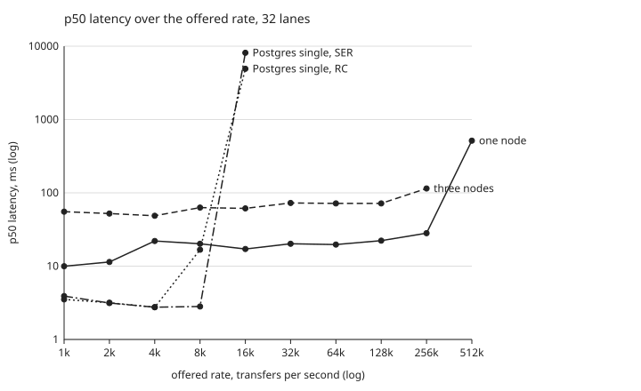
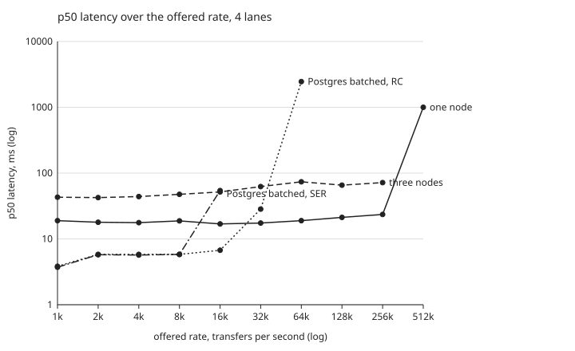
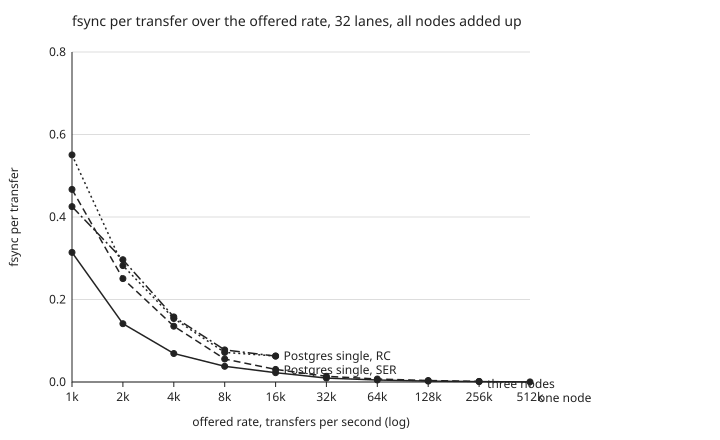

# Benchmark results

Generated by `bench report` from the files in `raw/`; the same files give the same bytes. Change the raw files, not this file: `bench check` compares it with what the raw files give.

Each figure is the median over the counted runs of its row, with the smallest and the largest value in brackets; "runs" says how many runs were counted out of how many were made. A run counts when it is valid and ran at the disk speed of its row. A row shows the slow disk speed when any of its valid runs reached it, otherwise the fast one, marked as such. Within a run only the valid seconds of its disk speed count. Latency is counted from the moment a transfer was scheduled, not from the moment it was sent. "flushes" is a latency divided by the mean flush time of the disk in the same run. p99.9 is listed for completeness and is not compared. "seconds" counts the window seconds of the counted runs that entered the figures, out of all their window seconds, with the highest p99 of a second that was left out. "target cpu" is the CPU time of the target processes divided by the hardware threads they were given, the mean over the window. "fsync per transfer, all nodes" adds up the fsyncs of every node of a cluster and divides them by the confirmed transfers; for a node these are its calls on the log, on meta and on any other file, for Postgres the syncs of its WAL. "flush ms" and "p50 flushes" rest on the flush time of the device, read from /proc/diskstats, not on the time an fsync call took. "given up" is the share of the transfers due in the counted seconds that Postgres gave up after 20 tries; a stage where more than 1 % of the transfers due in the window were given up counts as saturated. "retries per transfer" adds up the retries of the transfers due in the counted seconds, booked or given up, and divides them by the transfers booked in them. "thermal limit" counts the seconds in which the thermal counter of a target core rose.

## Stages (m1)

How many transfers per second does one node hold, how many a cluster of three nodes, and how does the wait grow with the load? Each stage offers a fixed rate for a fixed window. A stage is held when at the end of its window fewer arrivals are open than fall due in one second; otherwise it is saturated. The last held stage comes from the raster of stages, the throughput under overload is measured in the first saturated stage of each pass. Over the passes the last held stage is the median; with an even number of passes it is the lower of the two middle values, a stage that both of these passes held or went beyond. In the first table, "runs" counts the runs made at the stages the throughput under overload comes from, as the table of the chain does for each stage. The last held stage counts only stages that ran at the disk speed of the throughput under overload; where none held at that speed, the speed of the stage shown stands next to it. A row without a throughput under overload counts the stages at the slow speed, else at the fast one, and names the speed when it is not slow. Where the load generator and not the target was the limit, the table says "at least"; "budget" in the column "limit" marks a chain that ended because its next stage would not fit the transfers a run of the cluster may write.

| target | lanes | load | passes | last held stage | throughput under overload | runs | seconds | limit | agreement |
|---|---|---|---|---|---|---|---|---|---|
| one node | 32 | uniform-10k | 2 | at least 256,000 (256,000–256,000) | at least 480,490 (454,775–506,205) | 2 of 2 | 10 of 18, worst excluded p99 over 1,000 ms, thermal limit in 6 | generator | at least: the generator was the limit |
| one node | 4 | uniform-10k | 2 | at least 256,000 (256,000–256,000) | at least 391,340 | 1 of 3 | 6 of 9, worst excluded p99 over 2,000 ms, thermal limit in 4 | generator | at least: the generator was the limit |
| three nodes | 32 | uniform-10k | 2 | at least 128,000 (128,000–256,000) | not reached | 0 of 0 | n/a | budget | at least: a pass held every stage that fits the budget |
| three nodes | 4 | uniform-10k | 2 | at least 256,000 (256,000–256,000) | not reached | 0 of 0 | n/a | budget | at least: a pass held every stage that fits the budget |
| Postgres, one transaction per transfer, read committed | 32 | uniform-10k | 2 | 8,000 (8,000–8,000) | 8,824 (8,771–8,877) | 2 of 2 | 16 of 32, worst excluded p99 2,359 ms, thermal limit in 15 | target | agreed |
| Postgres, one transaction per transfer, serializable | 32 | uniform-10k | 3 | 8,000 (8,000–8,000) | 8,965 (7,838–8,997) | 3 of 3 | 29 of 52, worst excluded p99 10,486 ms, thermal limit in 24 | target | agreed |
| Postgres, batched, read committed | 4 | uniform-10k | 4 | 32,000 (32,000–32,000) | 44,917 (44,833–45,000) | 2 of 4 | 21 of 30, worst excluded p99 over 2,000 ms, thermal limit in 30 | target | agreed |
| Postgres, batched, serializable | 4 | uniform-10k | 2 | 8,000 (8,000–8,000) | 8,042 (8,000–8,083) | 2 of 2 | 22 of 30, worst excluded p99 over 2,000 ms, thermal limit in 10 | target | agreed |

Commit a6ee18b4574a9466b7046948f374ce95ad8f85a9; run on 2026-11-20; machine: 12th Gen Intel(R) Core(TM) i5-12500H, 16 threads, 15.3 GiB RAM, PC801 NVMe SK hynix 512GB (nvme0n1, ext4 rw,relatime), kernel 6.12.117+deb13-amd64, governor powersave, turbo on, power mains; disk speed: slow, mean flush 1.58 (1.50–2.31) ms.

The curves show the medians of the tables below; p99 is only in the tables.

### one node, 32 lanes, uniform-10k

| rate | held | speed | flush ms | runs | seconds | p50 ms | p50 flushes | p99 ms | p99.9 ms | throughput/s | target cpu | fsync per transfer, all nodes | transfers per request | retries per transfer | given up | agreement |
|---|---|---|---|---|---|---|---|---|---|---|---|---|---|---|---|---|
| 1,000 | held | slow | 1.70 (1.59–1.81) | 2 of 2 | 23 of 31, worst excluded p99 16.4 ms, thermal limit in 2 | 9.98 (9.47–10.5) | 5.9 (5.8–5.9) | 17.3 (15.6–18.9) | 24.3 (22.0–26.6) | 1,000 (1,000–1,000) | 2.6% (2.5%–2.7%) | 0.314 (0.294–0.334) | 1.0 (1.0–1.0) | 0.000 (0.000–0.000) | 0.0% (0.0%–0.0%) | undecided: no pair on an equally fast disk in 2 runs |
| 2,000 | held | slow | 1.61 (1.55–1.68) | 2 of 2 | 25 of 30, worst excluded p99 35.8 ms, thermal limit in 10 | 11.4 (10.8–12.0) | 7.1 (6.9–7.2) | 26.1 (21.5–30.7) | 41.0 (27.6–54.3) | 2,000 (2,000–2,001) | 3.6% (3.5%–3.7%) | 0.141 (0.138–0.145) | 1.0 (1.0–1.0) | 0.000 (0.000–0.000) | 0.0% (0.0%–0.0%) | missed: p50 10.752ms against 12.032ms |
| 4,000 | held | slow | 1.62 (1.60–1.65) | 2 of 2 | 24 of 30, worst excluded p99 37.9 ms, thermal limit in 6 | 22.0 (22.0–22.0) | 13.6 (13.4–13.8) | 34.6 (32.3–36.9) | 42.5 (42.0–43.0) | 4,001 (3,999–4,003) | 2.0% (1.9%–2.1%) | 0.069 (0.069–0.070) | 1.8 (1.8–1.8) | 0.000 (0.000–0.000) | 0.0% (0.0%–0.0%) | agreed |
| 8,000 | held | slow | 1.63 (1.57–1.69) | 2 of 2 | 20 of 30, worst excluded p99 46.1 ms, thermal limit in 11 | 20.2 (17.9–22.5) | 12.4 (11.4–13.3) | 35.3 (31.7–38.9) | 44.0 (41.0–47.1) | 8,005 (8,003–8,008) | 2.7% (2.6%–2.9%) | 0.038 (0.034–0.043) | 3.3 (2.9–3.7) | 0.000 (0.000–0.000) | 0.0% (0.0%–0.0%) | missed: p50 22.528ms against 17.92ms |
| 16,000 | held | slow | 1.56 (1.55–1.57) | 2 of 2 | 18 of 30, worst excluded p99 31.7 ms, thermal limit in 7 | 17.2 (16.9–17.4) | 11.0 (10.9–11.1) | 25.6 (25.1–26.1) | 36.4 (33.8–38.9) | 16,007 (16,002–16,013) | 5.2% (4.7%–5.6%) | 0.022 (0.022–0.023) | 5.6 (5.5–5.7) | 0.000 (0.000–0.000) | 0.0% (0.0%–0.0%) | agreed |
| 32,000 | held | slow | 1.67 (1.60–1.74) | 2 of 2 | 22 of 30, worst excluded p99 36.9 ms, thermal limit in 5 | 20.2 (20.0–20.5) | 12.1 (11.7–12.5) | 34.0 (32.3–35.8) | 44.5 (41.0–48.1) | 31,993 (31,991–31,996) | 3.8% (3.6%–4.0%) | 0.009 (0.009–0.009) | 13.2 (13.2–13.2) | 0.000 (0.000–0.000) | 0.0% (0.0%–0.0%) | agreed |
| 64,000 | held | slow | 1.60 (1.54–1.67) | 2 of 2 | 16 of 33, worst excluded p99 41.0 ms, thermal limit in 13 | 19.7 (17.4–22.0) | 12.3 (11.3–13.2) | 33.5 (27.1–39.9) | 43.5 (35.8–51.2) | 63,935 (63,926–63,945) | 6.6% (6.2%–6.9%) | 0.005 (0.004–0.006) | 25.5 (22.7–28.4) | 0.000 (0.000–0.000) | 0.0% (0.0%–0.0%) | missed: p50 22.016ms against 17.408ms |
| 128,000 | held | slow | 1.59 (1.58–1.60) | 2 of 2 | 16 of 30, worst excluded p99 49.2 ms, thermal limit in 4 | 22.3 (21.0–23.6) | 14.0 (13.3–14.7) | 33.0 (30.2–35.8) | 44.0 (42.0–46.1) | 128,078 (128,005–128,152) | 9.6% (9.1%–10.2%) | 0.002 (0.002–0.002) | 57.5 (54.2–60.8) | 0.000 (0.000–0.000) | 0.0% (0.0%–0.0%) | missed: p50 20.992ms against 23.552ms |
| 256,000 | held | slow | 1.63 (1.52–1.75) | 2 of 2 | 20 of 36, worst excluded p99 139 ms, thermal limit in 10 | 28.2 (25.1–31.2) | 17.2 (16.5–17.9) | 48.1 (44.0–52.2) | 54.8 (50.2–59.4) | 256,149 (255,959–256,339) | 15.4% (15.3%–15.6%) | 0.001 (0.001–0.001) | 141.3 (121.3–161.3) | 0.000 (0.000–0.000) | 0.0% (0.0%–0.0%) | undecided: no pair on an equally fast disk in 2 runs |
| 512,000 | saturated at 512,000 | slow | 1.58 (1.57–1.58) | 2 of 2 | 10 of 18, worst excluded p99 over 1,000 ms, thermal limit in 6 | 514 (160–868) | 324.9 (101.8–548.0) | over 1,000 (over 1,000–over 1,000) | over 1,000 (over 1,000–over 1,000) | at least 480,490 (454,775–506,205) | 22.1% (20.4%–23.8%) | 0.000 (0.000–0.000) | 1047.4 (978.0–1116.8) | 0.000 (0.000–0.000) | 0.0% (0.0%–0.0%) | at least: the generator was the limit |

Commit a6ee18b4574a9466b7046948f374ce95ad8f85a9; run on 2026-11-20; machine: 12th Gen Intel(R) Core(TM) i5-12500H, 16 threads, 15.3 GiB RAM, PC801 NVMe SK hynix 512GB (nvme0n1, ext4 rw,relatime), kernel 6.12.117+deb13-amd64, governor powersave, turbo on, power mains; disk speed: slow, mean flush 1.60 (1.52–1.81) ms.

### one node, 4 lanes, uniform-10k

| rate | held | speed | flush ms | runs | seconds | p50 ms | p50 flushes | p99 ms | p99.9 ms | throughput/s | target cpu | fsync per transfer, all nodes | transfers per request | retries per transfer | given up | agreement |
|---|---|---|---|---|---|---|---|---|---|---|---|---|---|---|---|---|
| 1,000 | held | slow | 1.54 (1.50–1.58) | 2 of 2 | 21 of 32, worst excluded p99 31.7 ms, thermal limit in 2 | 18.9 (18.4–19.5) | 12.3 (12.3–12.3) | 30.0 (29.7–30.2) | 34.8 (34.8–34.8) | 1,002 (1,000–1,003) | 1.8% (1.3%–2.3%) | 0.332 (0.316–0.347) | 3.1 (2.9–3.2) | 0.000 (0.000–0.000) | 0.0% (0.0%–0.0%) | agreed |
| 2,000 | held | slow | 1.57 (1.56–1.58) | 2 of 2 | 22 of 30, worst excluded p99 26.6 ms, thermal limit in 8 | 17.9 (16.9–18.9) | 11.4 (10.8–12.0) | 27.6 (24.6–30.7) | 36.4 (34.8–37.9) | 2,000 (2,000–2,000) | 1.7% (1.5%–1.9%) | 0.172 (0.161–0.182) | 5.8 (5.5–6.2) | 0.000 (0.000–0.000) | 0.0% (0.0%–0.0%) | missed: p50 16.896ms against 18.944ms |
| 4,000 | held | slow | 1.57 (1.56–1.58) | 2 of 2 | 19 of 32, worst excluded p99 29.7 ms, thermal limit in 8 | 17.7 (16.9–18.4) | 11.2 (10.8–11.7) | 27.6 (24.6–30.7) | 34.3 (33.8–34.8) | 3,999 (3,998–3,999) | 1.8% (1.5%–2.1%) | 0.087 (0.084–0.091) | 11.4 (11.0–11.9) | 0.000 (0.000–0.000) | 0.0% (0.0%–0.0%) | agreed |
| 8,000 | held | slow | 1.55 (1.52–1.57) | 2 of 2 | 16 of 30, worst excluded p99 31.7 ms, thermal limit in 7 | 18.8 (16.1–21.5) | 12.1 (10.6–13.7) | 28.4 (25.1–31.7) | 34.3 (33.8–34.8) | 7,994 (7,989–7,999) | 2.5% (2.5%–2.6%) | 0.041 (0.035–0.047) | 24.8 (21.2–28.4) | 0.000 (0.000–0.000) | 0.0% (0.0%–0.0%) | missed: p50 21.504ms against 16.128ms |
| 16,000 | held | slow | 1.56 (1.53–1.58) | 2 of 2 | 23 of 34, worst excluded p99 38.9 ms, thermal limit in 7 | 16.9 (16.4–17.4) | 10.8 (10.7–11.0) | 26.4 (24.6–28.2) | 32.3 (32.3–32.3) | 16,007 (16,003–16,011) | 2.3% (1.9%–2.6%) | 0.023 (0.022–0.023) | 43.9 (42.7–45.1) | 0.000 (0.000–0.000) | 0.0% (0.0%–0.0%) | agreed |
| 32,000 | held | slow | 1.55 (1.54–1.55) | 2 of 2 | 22 of 30, worst excluded p99 34.8 ms, thermal limit in 7 | 17.4 (17.4–17.4) | 11.2 (11.2–11.3) | 25.6 (25.6–25.6) | 30.0 (27.6–32.3) | 31,996 (31,972–32,020) | 2.7% (2.7%–2.8%) | 0.011 (0.011–0.011) | 90.4 (89.5–91.3) | 0.000 (0.000–0.000) | 0.0% (0.0%–0.0%) | agreed |
| 64,000 | held | slow | 1.58 (1.58–1.58) | 2 of 2 | 22 of 30, worst excluded p99 31.2 ms, thermal limit in 9 | 18.9 (18.9–18.9) | 12.0 (12.0–12.0) | 29.2 (28.7–29.7) | 49.2 (44.0–54.3) | 64,007 (64,004–64,011) | 4.3% (4.1%–4.4%) | 0.005 (0.005–0.005) | 196.5 (195.2–197.8) | 0.000 (0.000–0.000) | 0.0% (0.0%–0.0%) | agreed |
| 128,000 | held | slow | 1.59 (1.52–1.65) | 2 of 2 | 16 of 33, worst excluded p99 51.2 ms, thermal limit in 10 | 21.2 (18.4–24.1) | 13.4 (12.1–14.6) | 33.8 (28.7–38.9) | 43.0 (37.9–48.1) | 127,794 (127,768–127,820) | 7.3% (7.1%–7.6%) | 0.002 (0.002–0.003) | 438.3 (381.4–495.2) | 0.000 (0.000–0.000) | 0.0% (0.0%–0.0%) | missed: p50 18.432ms against 24.064ms |
| 256,000 | held | slow | 1.57 (1.57–1.58) | 2 of 2 | 28 of 36, worst excluded p99 63.5 ms, thermal limit in 9 | 23.6 (23.6–23.6) | 15.0 (14.9–15.0) | 40.4 (39.9–41.0) | 47.6 (47.1–48.1) | 256,034 (255,896–256,172) | 12.4% (11.8%–13.1%) | 0.001 (0.001–0.001) | 953.7 (946.7–960.8) | 0.000 (0.000–0.000) | 0.0% (0.0%–0.0%) | agreed |
| 512,000 | saturated at 512,000 | slow | 2.31 | 1 of 3 | 6 of 9, worst excluded p99 over 2,000 ms, thermal limit in 4 | 999 | 432.1 | over 2,000 | over 2,000 | at least 391,340 | 16.2% | 0.000 | 8632.5 | 0.000 | 0.0% | at least: the generator was the limit |

Commit a6ee18b4574a9466b7046948f374ce95ad8f85a9; run on 2026-11-20; machine: 12th Gen Intel(R) Core(TM) i5-12500H, 16 threads, 15.3 GiB RAM, PC801 NVMe SK hynix 512GB (nvme0n1, ext4 rw,relatime), kernel 6.12.117+deb13-amd64, governor powersave, turbo on, power mains; disk speed: slow, mean flush 1.57 (1.50–2.31) ms.

### three nodes, 32 lanes, uniform-10k

| rate | held | speed | flush ms | runs | seconds | p50 ms | p50 flushes | p99 ms | p99.9 ms | throughput/s | target cpu | fsync per transfer, all nodes | transfers per request | retries per transfer | given up | agreement |
|---|---|---|---|---|---|---|---|---|---|---|---|---|---|---|---|---|
| 1,000 | held | slow | 1.58 (1.55–1.60) | 2 of 2 | 23 of 30, worst excluded p99 88.1 ms, thermal limit in 2 | 55.3 (51.2–59.4) | 35.0 (33.0–37.1) | 99.3 (96.3–102) | 112 (109–115) | 999 (999–1,000) | 1.5% (1.2%–1.9%) | 0.467 (0.431–0.503) | 1.2 (1.1–1.2) | 0.000 (0.000–0.000) | 0.0% (0.0%–0.0%) | missed: p50 59.392ms against 51.2ms |
| 2,000 | held | slow | 1.55 (1.54–1.56) | 2 of 2 | 25 of 30, worst excluded p99 77.8 ms, thermal limit in 5 | 52.2 (49.2–55.3) | 33.6 (31.8–35.3) | 91.1 (86.0–96.3) | 99.3 (92.2–106) | 1,998 (1,995–2,002) | 1.6% (1.4%–1.8%) | 0.251 (0.233–0.268) | 2.1 (2.0–2.3) | 0.000 (0.000–0.000) | 0.0% (0.0%–0.0%) | missed: p50 55.296ms against 49.152ms |
| 4,000 | held | slow | 1.53 (1.53–1.53) | 2 of 2 | 17 of 30, worst excluded p99 102 ms, thermal limit in 7 | 48.6 (48.1–49.2) | 31.8 (31.5–32.1) | 81.9 (81.9–81.9) | 93.2 (92.2–94.2) | 4,003 (4,001–4,006) | 1.8% (1.7%–1.9%) | 0.135 (0.134–0.136) | 4.0 (4.0–4.0) | 0.000 (0.000–0.000) | 0.0% (0.0%–0.0%) | agreed |
| 8,000 | held | slow | 1.58 (1.57–1.59) | 2 of 2 | 26 of 30, worst excluded p99 96.3 ms, thermal limit in 3 | 63.0 (61.4–64.5) | 39.9 (39.2–40.7) | 106 (106–106) | 117 (117–117) | 7,984 (7,981–7,987) | 1.6% (1.6%–1.6%) | 0.056 (0.054–0.058) | 10.2 (9.8–10.5) | 0.000 (0.000–0.000) | 0.0% (0.0%–0.0%) | agreed |
| 16,000 | held | slow | 1.59 (1.56–1.63) | 2 of 2 | 19 of 32, worst excluded p99 92.2 ms, thermal limit in 8 | 61.4 (57.3–65.5) | 38.5 (36.8–40.3) | 105 (96.3–115) | 117 (104–129) | 15,943 (15,864–16,021) | 2.6% (2.5%–2.8%) | 0.030 (0.028–0.033) | 19.8 (18.4–21.2) | 0.000 (0.000–0.000) | 0.0% (0.0%–0.0%) | missed: p50 65.536ms against 57.344ms |
| 32,000 | held | slow | 1.60 (1.58–1.62) | 2 of 2 | 23 of 30, worst excluded p99 113 ms, thermal limit in 7 | 72.7 (67.6–77.8) | 45.5 (41.8–49.1) | 121 (115–127) | 135 (123–147) | 32,005 (31,911–32,099) | 3.2% (2.9%–3.5%) | 0.014 (0.013–0.015) | 47.7 (44.1–51.3) | 0.000 (0.000–0.000) | 0.0% (0.0%–0.0%) | missed: p50 67.584ms against 77.824ms |
| 64,000 | held | slow | 1.63 (1.56–1.69) | 2 of 2 | 40 of 48, worst excluded p99 98.3 ms, thermal limit in 7 | 71.7 (63.5–79.9) | 43.9 (40.7–47.1) | 126 (113–139) | 142 (129–156) | 63,955 (63,890–64,020) | 4.9% (4.5%–5.4%) | 0.007 (0.006–0.008) | 92.8 (82.1–103.5) | 0.000 (0.000–0.000) | 0.0% (0.0%–0.0%) | missed: p50 79.872ms against 63.488ms |
| 128,000 | held | slow | 1.63 (1.57–1.69) | 2 of 2 | 13 of 24, worst excluded p99 119 ms, thermal limit in 8 | 71.7 (69.6–73.7) | 44.0 (43.5–44.5) | 124 (119–129) | 141 (139–143) | 128,084 (127,938–128,231) | 8.7% (8.5%–8.8%) | 0.004 (0.003–0.004) | 185.3 (179.6–191.0) | 0.000 (0.000–0.000) | 0.0% (0.0%–0.0%) | agreed |
| 256,000 | held | slow | 1.57 | 1 of 3 | 5 of 6, worst excluded p99 131 ms, thermal limit in 1 | 115 | 72.8 | 270 | 311 | 258,196 | 14.4% | 0.001 | 585.7 | 0.000 | 0.0% | undecided: no pair on an equally fast disk in 1 runs |

Each node on its own:

| rate | speed | runs | fsync per transfer, leader | fsync per transfer, one follower |
|---|---|---|---|---|
| 1,000 | slow | 2 | 0.213 (0.194–0.232) | 0.127 (0.118–0.135) |
| 2,000 | slow | 2 | 0.111 (0.104–0.118) | 0.070 (0.065–0.075) |
| 4,000 | slow | 2 | 0.060 (0.059–0.062) | 0.037 (0.037–0.037) |
| 8,000 | slow | 2 | 0.024 (0.023–0.024) | 0.016 (0.015–0.017) |
| 16,000 | slow | 2 | 0.012 (0.012–0.013) | 0.009 (0.008–0.010) |
| 32,000 | slow | 2 | 0.005 (0.005–0.006) | 0.004 (0.004–0.005) |
| 64,000 | slow | 2 | 0.003 (0.002–0.003) | 0.002 (0.002–0.002) |
| 128,000 | slow | 2 | 0.001 (0.001–0.001) | 0.001 (0.001–0.001) |
| 256,000 | slow | 1 | 0.001 | 0.000 |

Commit a6ee18b4574a9466b7046948f374ce95ad8f85a9; run on 2026-11-20; machine: 12th Gen Intel(R) Core(TM) i5-12500H, 16 threads, 15.3 GiB RAM, PC801 NVMe SK hynix 512GB (nvme0n1, ext4 rw,relatime), kernel 6.12.117+deb13-amd64, governor powersave, turbo on, power mains; disk speed: slow, mean flush 1.57 (1.53–1.69) ms.

### three nodes, 4 lanes, uniform-10k

| rate | held | speed | flush ms | runs | seconds | p50 ms | p50 flushes | p99 ms | p99.9 ms | throughput/s | target cpu | fsync per transfer, all nodes | transfers per request | retries per transfer | given up | agreement |
|---|---|---|---|---|---|---|---|---|---|---|---|---|---|---|---|---|
| 1,000 | held | slow | 1.54 (1.52–1.56) | 2 of 2 | 16 of 30, worst excluded p99 79.9 ms, thermal limit in 3 | 43.0 (38.9–47.1) | 27.9 (25.7–30.2) | 76.8 (67.6–86.0) | 87.0 (75.8–98.3) | 999 (999–999) | 1.9% (1.9%–1.9%) | 0.534 (0.489–0.579) | 7.0 (6.4–7.6) | 0.000 (0.000–0.000) | 0.0% (0.0%–0.0%) | missed: p50 38.912ms against 47.104ms |
| 2,000 | held | slow | 1.54 (1.52–1.56) | 2 of 2 | 19 of 30, worst excluded p99 86.0 ms, thermal limit in 7 | 42.5 (39.9–45.1) | 27.6 (26.2–29.0) | 77.8 (69.6–86.0) | 91.1 (81.9–100) | 1,999 (1,999–2,000) | 1.5% (1.2%–1.8%) | 0.267 (0.255–0.279) | 14.0 (13.2–14.8) | 0.000 (0.000–0.000) | 0.0% (0.0%–0.0%) | missed: p50 45.056ms against 39.936ms |
| 4,000 | held | slow | 1.57 (1.56–1.58) | 2 of 2 | 24 of 30, worst excluded p99 86.0 ms, thermal limit in 7 | 44.0 (41.0–47.1) | 28.0 (26.2–29.7) | 82.9 (75.8–90.1) | 97.3 (88.1–106) | 4,000 (3,995–4,005) | 1.3% (1.3%–1.3%) | 0.128 (0.119–0.137) | 28.9 (27.0–30.8) | 0.000 (0.000–0.000) | 0.0% (0.0%–0.0%) | missed: p50 40.96ms against 47.104ms |
| 8,000 | held | slow | 1.62 (1.57–1.68) | 2 of 2 | 18 of 30, worst excluded p99 96.3 ms, thermal limit in 5 | 47.6 (45.1–50.2) | 29.3 (28.8–29.8) | 94.2 (88.1–100) | 110 (100–119) | 7,978 (7,975–7,981) | 2.0% (2.0%–2.0%) | 0.061 (0.059–0.063) | 61.4 (58.3–64.6) | 0.000 (0.000–0.000) | 0.0% (0.0%–0.0%) | missed: p50 50.176ms against 45.056ms |
| 16,000 | held | slow | 1.57 (1.56–1.58) | 2 of 2 | 20 of 30, worst excluded p99 117 ms, thermal limit in 7 | 51.7 (48.1–55.3) | 33.0 (30.9–35.1) | 101 (100–102) | 112 (109–115) | 15,973 (15,937–16,008) | 2.4% (1.9%–2.8%) | 0.030 (0.029–0.032) | 133.7 (123.6–143.7) | 0.000 (0.000–0.000) | 0.0% (0.0%–0.0%) | missed: p50 48.128ms against 55.296ms |
| 32,000 | held | slow | 1.57 (1.57–1.58) | 2 of 2 | 21 of 30, worst excluded p99 100 ms, thermal limit in 3 | 62.5 (61.4–63.5) | 39.7 (39.2–40.2) | 111 (111–111) | 121 (117–125) | 31,909 (31,889–31,929) | 3.1% (3.1%–3.1%) | 0.015 (0.014–0.015) | 315.6 (311.1–320.2) | 0.000 (0.000–0.000) | 0.0% (0.0%–0.0%) | missed: fsync per transfer 0.015 against 0.014 |
| 64,000 | held | slow | 1.61 (1.59–1.63) | 2 of 2 | 33 of 48, worst excluded p99 111 ms, thermal limit in 10 | 73.7 (71.7–75.8) | 45.8 (45.1–46.4) | 123 (117–129) | 138 (129–147) | 63,983 (63,925–64,041) | 4.6% (4.3%–4.9%) | 0.007 (0.006–0.007) | 763.3 (751.1–775.5) | 0.000 (0.000–0.000) | 0.0% (0.0%–0.0%) | agreed |
| 128,000 | held | slow | 1.59 | 1 of 4 | 7 of 12, worst excluded p99 104 ms | 65.5 | 41.2 | 125 | 139 | 127,907 | 7.7% | 0.003 | 1362.8 | 0.000 | 0.0% | undecided: no pair on an equally fast disk in 1 runs |
| 256,000 | held | slow | 1.62 (1.60–1.64) | 2 of 2 | 8 of 12, worst excluded p99 180 ms, thermal limit in 4 | 71.7 (67.6–75.8) | 44.3 (41.2–47.3) | 123 (111–135) | 140 (129–152) | 256,758 (256,696–256,821) | 12.9% (12.8%–13.0%) | 0.002 (0.002–0.002) | 2829.4 (2760.2–2898.7) | 0.000 (0.000–0.000) | 0.0% (0.0%–0.0%) | missed: p50 75.776ms against 67.584ms |

Each node on its own:

| rate | speed | runs | fsync per transfer, leader | fsync per transfer, one follower |
|---|---|---|---|---|
| 1,000 | slow | 2 | 0.232 (0.213–0.251) | 0.151 (0.138–0.164) |
| 2,000 | slow | 2 | 0.118 (0.114–0.121) | 0.075 (0.070–0.079) |
| 4,000 | slow | 2 | 0.056 (0.052–0.061) | 0.036 (0.034–0.038) |
| 8,000 | slow | 2 | 0.027 (0.026–0.028) | 0.017 (0.017–0.018) |
| 16,000 | slow | 2 | 0.013 (0.012–0.014) | 0.009 (0.008–0.009) |
| 32,000 | slow | 2 | 0.006 (0.006–0.006) | 0.004 (0.004–0.005) |
| 64,000 | slow | 2 | 0.003 (0.002–0.003) | 0.002 (0.002–0.002) |
| 128,000 | slow | 1 | 0.001 | 0.001 |
| 256,000 | slow | 2 | 0.001 (0.001–0.001) | 0.000 (0.000–0.000) |

Commit a6ee18b4574a9466b7046948f374ce95ad8f85a9; run on 2026-11-20; machine: 12th Gen Intel(R) Core(TM) i5-12500H, 16 threads, 15.3 GiB RAM, PC801 NVMe SK hynix 512GB (nvme0n1, ext4 rw,relatime), kernel 6.12.117+deb13-amd64, governor powersave, turbo on, power mains; disk speed: slow, mean flush 1.58 (1.52–1.68) ms.

### Postgres, one transaction per transfer, read committed, 32 lanes, uniform-10k

| rate | held | speed | flush ms | runs | seconds | p50 ms | p50 flushes | p99 ms | p99.9 ms | throughput/s | target cpu | fsync per transfer, all nodes | transfers per request | retries per transfer | given up | agreement |
|---|---|---|---|---|---|---|---|---|---|---|---|---|---|---|---|---|
| 1,000 | held | slow | 1.70 | 1 of 2 | 8 of 16, worst excluded p99 7.94 ms, thermal limit in 4 | 3.52 | 2.1 | 6.66 | 17.9 | 1,000 | 3.2% | 0.551 | 1.0 | 0.000 | 0.0% | undecided: no pair on an equally fast disk in 1 runs |
| 2,000 | held | slow | 1.60 (1.58–1.62) | 2 of 2 | 20 of 34, worst excluded p99 11.3 ms, thermal limit in 9 | 3.17 (3.14–3.20) | 2.0 (2.0–2.0) | 5.44 (5.38–5.50) | 16.8 (16.1–17.4) | 2,000 (2,000–2,000) | 6.4% (5.8%–7.0%) | 0.282 (0.274–0.290) | 1.0 (1.0–1.0) | 0.000 (0.000–0.000) | 0.0% (0.0%–0.0%) | agreed |
| 4,000 | held | slow | 1.57 (1.56–1.58) | 2 of 2 | 28 of 30, worst excluded p99 8.45 ms, thermal limit in 4 | 2.75 (2.75–2.75) | 1.8 (1.7–1.8) | 4.45 (3.90–4.99) | 10.2 (9.73–10.8) | 4,000 (4,000–4,000) | 9.5% (9.5%–9.6%) | 0.154 (0.151–0.157) | 1.0 (1.0–1.0) | 0.000 (0.000–0.000) | 0.0% (0.0%–0.0%) | agreed |
| 8,000 | held | slow | 1.62 (1.57–1.68) | 2 of 2 | 17 of 31, worst excluded p99 84.0 ms, thermal limit in 10 | 16.8 (2.82–30.7) | 10.0 (1.8–18.3) | 66.2 (11.5–121) | 72.2 (19.5–125) | 7,980 (7,958–8,001) | 19.5% (18.0%–21.0%) | 0.072 (0.067–0.076) | 1.0 (1.0–1.0) | 0.000 (0.000–0.000) | 0.0% (0.0%–0.0%) | missed: p50 2.816ms against 30.72ms |
| 16,000 | saturated at 16,000 | slow | 1.56 (1.55–1.57) | 2 of 2 | 16 of 32, worst excluded p99 2,359 ms, thermal limit in 15 | 4,915 (4,850–4,981) | 3150.3 (3118.8–3181.8) | over 5,000 (over 5,000–over 5,000) | over 5,000 (over 5,000–over 5,000) | 8,824 (8,771–8,877) | 38.5% (36.9%–40.0%) | 0.063 (0.063–0.063) | 1.0 (1.0–1.0) | 0.000 (0.000–0.000) | 0.0% (0.0%–0.0%) | agreed |

Commit a6ee18b4574a9466b7046948f374ce95ad8f85a9; run on 2026-11-20; machine: 12th Gen Intel(R) Core(TM) i5-12500H, 16 threads, 15.3 GiB RAM, PC801 NVMe SK hynix 512GB (nvme0n1, ext4 rw,relatime), kernel 6.12.117+deb13-amd64, governor powersave, turbo on, power mains; disk speed: slow, mean flush 1.58 (1.55–1.70) ms.

### Postgres, one transaction per transfer, serializable, 32 lanes, uniform-10k

| rate | held | speed | flush ms | runs | seconds | p50 ms | p50 flushes | p99 ms | p99.9 ms | throughput/s | target cpu | fsync per transfer, all nodes | transfers per request | retries per transfer | given up | agreement |
|---|---|---|---|---|---|---|---|---|---|---|---|---|---|---|---|---|
| 1,000 | held | slow | 1.85 | 1 of 3 | 8 of 16, worst excluded p99 5.38 ms | 3.90 | 2.1 | 7.42 | 20.5 | 1,000 | 3.3% | 0.425 | 1.0 | 0.001 | 0.0% | undecided: no pair on an equally fast disk in 1 runs |
| 2,000 | held | slow | 1.59 (1.58–1.63) | 3 of 3 | 24 of 54, worst excluded p99 11.8 ms, thermal limit in 12 | 3.14 (3.07–3.20) | 2.0 (1.9–2.0) | 4.61 (4.48–5.76) | 7.68 (6.27–14.8) | 2,000 (2,000–2,000) | 5.6% (5.5%–5.9%) | 0.296 (0.291–0.322) | 1.0 (1.0–1.0) | 0.002 (0.002–0.003) | 0.0% (0.0%–0.0%) | agreed |
| 4,000 | held | slow | 1.54 (1.54–1.55) | 3 of 3 | 35 of 46, worst excluded p99 9.22 ms, thermal limit in 10 | 2.75 (2.75–2.75) | 1.8 (1.8–1.8) | 4.74 (4.03–5.12) | 14.6 (7.68–16.9) | 4,000 (3,998–4,000) | 9.9% (9.4%–10.4%) | 0.158 (0.152–0.178) | 1.0 (1.0–1.0) | 0.004 (0.004–0.004) | 0.0% (0.0%–0.0%) | missed: fsync per transfer 0.152 against 0.178 |
| 8,000 | held | slow | 1.57 (1.53–1.64) | 3 of 3 | 31 of 45, worst excluded p99 20.5 ms, thermal limit in 15 | 2.82 (2.75–3.52) | 1.8 (1.8–2.2) | 12.3 (6.66–54.3) | 18.4 (8.96–59.4) | 7,999 (7,999–8,001) | 19.6% (19.1%–21.6%) | 0.078 (0.071–0.078) | 1.0 (1.0–1.0) | 0.008 (0.008–0.008) | 0.0% (0.0%–0.0%) | missed: p50 3.52ms against 2.752ms |
| 16,000 | saturated at 16,000 | slow | 1.55 (1.53–1.79) | 3 of 3 | 29 of 52, worst excluded p99 10,486 ms, thermal limit in 24 | 8,126 (3,342–8,651) | 4537.7 (2178.5–5572.6) | over 5,000 (over 5,000–over 5,000) | over 5,000 (over 5,000–over 5,000) | 8,965 (7,838–8,997) | 39.0% (25.7%–46.9%) | 0.063 (0.062–0.063) | 1.0 (1.0–1.0) | 0.006 (0.005–0.009) | 0.0% (0.0%–0.0%) | agreed |

Commit a6ee18b4574a9466b7046948f374ce95ad8f85a9; run on 2026-11-20; machine: 12th Gen Intel(R) Core(TM) i5-12500H, 16 threads, 15.3 GiB RAM, PC801 NVMe SK hynix 512GB (nvme0n1, ext4 rw,relatime), kernel 6.12.117+deb13-amd64, governor powersave, turbo on, power mains; disk speed: slow, mean flush 1.57 (1.53–1.85) ms.

### Postgres, batched, read committed, 4 lanes, uniform-10k

| rate | held | speed | flush ms | runs | seconds | p50 ms | p50 flushes | p99 ms | p99.9 ms | throughput/s | target cpu | fsync per transfer, all nodes | transfers per request | retries per transfer | given up | agreement |
|---|---|---|---|---|---|---|---|---|---|---|---|---|---|---|---|---|
| 1,000 | held | slow | 1.64 | 1 of 4 | 8 of 16, worst excluded p99 10.5 ms | 3.84 | 2.3 | 9.47 | 21.0 | 1,000 | 5.6% | 0.531 | 1.0 | 0.000 | 0.0% | undecided: no pair on an equally fast disk in 1 runs |
| 2,000 | held | slow | 1.61 (1.57–1.70) | 4 of 4 | 44 of 60, worst excluded p99 17.9 ms, thermal limit in 17 | 5.82 (5.63–6.02) | 3.6 (3.5–3.6) | 9.47 (8.06–12.0) | 15.2 (9.98–23.0) | 2,000 (2,000–2,001) | 7.7% (7.3%–8.4%) | 0.268 (0.259–0.276) | 1.9 (1.8–2.0) | 0.000 (0.000–0.000) | 0.0% (0.0%–0.0%) | agreed |
| 4,000 | held | slow | 1.61 (1.57–1.69) | 4 of 4 | 45 of 61, worst excluded p99 18.9 ms, thermal limit in 7 | 5.82 (5.63–6.02) | 3.6 (3.6–3.6) | 9.86 (8.96–11.5) | 19.5 (12.0–22.5) | 4,000 (4,000–4,001) | 9.7% (8.1%–10.9%) | 0.134 (0.129–0.137) | 3.8 (3.7–3.9) | 0.000 (0.000–0.000) | 0.0% (0.0%–0.0%) | agreed |
| 8,000 | held | slow | 1.58 (1.57–1.68) | 4 of 4 | 36 of 66, worst excluded p99 20.5 ms, thermal limit in 18 | 5.82 (5.76–6.14) | 3.7 (3.7–3.7) | 11.0 (10.8–15.9) | 18.2 (13.3–25.6) | 8,000 (7,998–8,011) | 8.4% (7.6%–10.0%) | 0.066 (0.065–0.069) | 7.6 (7.6–8.1) | 0.000 (0.000–0.000) | 0.0% (0.0%–0.0%) | agreed |
| 16,000 | held | slow | 1.59 (1.56–1.60) | 4 of 4 | 42 of 60, worst excluded p99 19.5 ms, thermal limit in 20 | 6.72 (6.53–6.78) | 4.2 (4.2–4.2) | 17.7 (15.9–18.4) | 23.3 (20.5–32.3) | 16,001 (15,993–16,005) | 11.6% (10.0%–12.4%) | 0.033 (0.032–0.034) | 18.1 (17.6–18.3) | 0.000 (0.000–0.000) | 0.0% (0.0%–0.0%) | agreed |
| 32,000 | held | slow | 1.58 (1.56–1.65) | 4 of 4 | 46 of 60, worst excluded p99 152 ms, thermal limit in 18 | 28.4 (27.6–30.7) | 18.0 (17.6–18.6) | 66.6 (63.5–79.9) | 78.8 (77.8–100) | 31,991 (31,953–32,028) | 11.1% (10.9%–14.2%) | 0.007 (0.007–0.007) | 139.7 (137.3–150.4) | 0.000 (0.000–0.000) | 0.0% (0.0%–0.0%) | agreed |
| 64,000 | saturated at 64,000 | slow | 1.63 (1.60–1.67) | 2 of 4 | 21 of 30, worst excluded p99 over 2,000 ms, thermal limit in 30 | 2,458 (2,359–2,556) | 1506.1 (1415.6–1596.6) | over 2,000 (over 2,000–over 2,000) | over 2,000 (over 2,000–over 2,000) | 44,917 (44,833–45,000) | 16.6% (16.4%–16.8%) | 0.001 (0.001–0.001) | 1000.0 (1000.0–1000.0) | 0.000 (0.000–0.000) | 0.0% (0.0%–0.0%) | agreed |

Commit a6ee18b4574a9466b7046948f374ce95ad8f85a9; run on 2026-11-20; machine: 12th Gen Intel(R) Core(TM) i5-12500H, 16 threads, 15.3 GiB RAM, PC801 NVMe SK hynix 512GB (nvme0n1, ext4 rw,relatime), kernel 6.12.117+deb13-amd64, governor powersave, turbo on, power mains; disk speed: slow, mean flush 1.60 (1.56–1.70) ms.

### Postgres, batched, serializable, 4 lanes, uniform-10k

| rate | held | speed | flush ms | runs | seconds | p50 ms | p50 flushes | p99 ms | p99.9 ms | throughput/s | target cpu | fsync per transfer, all nodes | transfers per request | retries per transfer | given up | agreement |
|---|---|---|---|---|---|---|---|---|---|---|---|---|---|---|---|---|
| 1,000 | held | slow | 1.61 | 1 of 2 | 14 of 15, worst excluded p99 6.27 ms, thermal limit in 2 | 3.71 | 2.3 | 8.70 | 21.0 | 1,000 | 6.5% | 0.537 | 1.0 | 0.001 | 0.0% | undecided: no pair on an equally fast disk in 1 runs |
| 2,000 | held | slow | 1.59 (1.59–1.60) | 2 of 2 | 16 of 33, worst excluded p99 20.5 ms, thermal limit in 10 | 5.76 (5.76–5.76) | 3.6 (3.6–3.6) | 8.45 (8.19–8.70) | 11.1 (10.8–11.5) | 2,000 (2,000–2,001) | 8.4% (8.4%–8.5%) | 0.270 (0.267–0.272) | 1.9 (1.8–1.9) | 0.003 (0.003–0.004) | 0.0% (0.0%–0.0%) | agreed |
| 4,000 | held | slow | 1.60 (1.59–1.61) | 2 of 2 | 19 of 30, worst excluded p99 11.0 ms, thermal limit in 6 | 5.70 (5.63–5.76) | 3.6 (3.5–3.6) | 10.2 (8.96–11.5) | 15.6 (11.8–19.5) | 4,000 (3,999–4,000) | 10.9% (10.0%–11.9%) | 0.135 (0.134–0.136) | 3.7 (3.7–3.7) | 0.016 (0.014–0.018) | 0.0% (0.0%–0.0%) | agreed |
| 8,000 | held | slow | 1.57 (1.51–1.62) | 2 of 2 | 19 of 30, worst excluded p99 21.5 ms, thermal limit in 8 | 5.82 (5.76–5.89) | 3.7 (3.6–3.8) | 12.5 (12.3–12.8) | 20.5 (17.9–23.0) | 8,008 (8,005–8,012) | 9.4% (9.3%–9.4%) | 0.068 (0.067–0.068) | 7.5 (7.3–7.8) | 0.067 (0.065–0.069) | 0.0% (0.0%–0.0%) | agreed |
| 16,000 | saturated at 16,000 | slow | 1.57 (1.56–1.59) | 2 of 2 | 22 of 30, worst excluded p99 over 2,000 ms, thermal limit in 10 | 54.3 (41.0–67.6) | 34.6 (25.8–43.4) | over 2,000 (over 2,000–over 2,000) | over 2,000 (over 2,000–over 2,000) | 8,042 (8,000–8,083) | 7.5% (7.2%–7.8%) | 0.065 (0.065–0.066) | 15.6 (15.3–15.8) | 6.864 (6.148–7.579) | 15.8% (13.8%–17.8%) | agreed |

Commit a6ee18b4574a9466b7046948f374ce95ad8f85a9; run on 2026-11-20; machine: 12th Gen Intel(R) Core(TM) i5-12500H, 16 threads, 15.3 GiB RAM, PC801 NVMe SK hynix 512GB (nvme0n1, ext4 rw,relatime), kernel 6.12.117+deb13-amd64, governor powersave, turbo on, power mains; disk speed: slow, mean flush 1.59 (1.51–1.62) ms.

## Fixed load (m2)

How long does a transfer wait at a fixed, moderate load, and what do a million accounts, a few hot accounts and two-phase transfers change? "saturated at" marks a target that did not hold the load. With twophase, "rate" and "saturated at" count arrivals and "throughput/s" counts transfers, two for each arrival.

| target | lanes | load | rate | held | speed | flush ms | runs | seconds | p50 ms | p50 flushes | p99 ms | p99.9 ms | throughput/s | target cpu | fsync per transfer, all nodes | transfers per request | retries per transfer | given up | agreement |
|---|---|---|---|---|---|---|---|---|---|---|---|---|---|---|---|---|---|---|---|
| one node | 32 | uniform-10k | 2,000 | held | slow | 1.64 (1.58–1.70) | 2 of 2 | 60 of 70, worst excluded p99 15.1 ms | 10.5 (9.47–11.5) | 6.4 (6.0–6.8) | 24.3 (15.9–32.8) | 34.8 (25.6–44.0) | 1,999 (1,999–2,000) | 3.7% (3.7%–3.8%) | 0.153 (0.142–0.164) | 1.0 (1.0–1.0) | 0.000 (0.000–0.000) | 0.0% (0.0%–0.0%) | missed: p50 11.52ms against 9.472ms |
| one node | 4 | uniform-10k | 20,000 | held | slow | 1.56 (1.56–1.56) | 2 of 2 | 60 of 67, worst excluded p99 30.2 ms, thermal limit in 1 | 18.2 (17.4–18.9) | 11.7 (11.2–12.1) | 30.0 (29.7–30.2) | 40.4 (37.9–43.0) | 19,998 (19,998–19,999) | 2.2% (2.0%–2.4%) | 0.017 (0.016–0.017) | 59.5 (57.3–61.8) | 0.000 (0.000–0.000) | 0.0% (0.0%–0.0%) | agreed |
| three nodes | 32 | uniform-10k | 2,000 | held | slow | 1.58 (1.57–1.58) | 2 of 2 | 60 of 72, worst excluded p99 102 ms | 58.4 (57.3–59.4) | 37.0 (36.4–37.5) | 99.3 (98.3–100) | 111 (109–113) | 1,998 (1,998–1,998) | 1.5% (1.4%–1.6%) | 0.220 (0.217–0.224) | 2.4 (2.3–2.4) | 0.000 (0.000–0.000) | 0.0% (0.0%–0.0%) | agreed |
| three nodes | 32 | uniform-1m | 2,000 | held | slow | 1.61 (1.59–1.62) | 2 of 2 | 60 of 62, worst excluded p99 92.2 ms | 60.4 (59.4–61.4) | 37.6 (36.7–38.6) | 105 (104–106) | 120 (119–121) | 1,999 (1,999–2,000) | 1.3% (1.3%–1.3%) | 0.222 (0.216–0.229) | 2.4 (2.4–2.5) | 0.000 (0.000–0.000) | 0.0% (0.0%–0.0%) | agreed |
| three nodes | 32 | hot | 2,000 | held | slow | 1.56 (1.55–1.56) | 2 of 2 | 60 of 64, worst excluded p99 79.9 ms | 50.7 (48.1–53.2) | 32.5 (31.0–34.0) | 90.1 (81.9–98.3) | 103 (96.3–111) | 1,998 (1,998–1,999) | 1.4% (1.4%–1.5%) | 0.256 (0.242–0.271) | 2.1 (2.0–2.2) | 0.000 (0.000–0.000) | 0.0% (0.0%–0.0%) | missed: p50 48.128ms against 53.248ms |
| three nodes | 32 | twophase | 2,000 | held | slow | 1.58 (1.57–1.59) | 2 of 2 | 60 of 67, worst excluded p99 180 ms, thermal limit in 1 | 139 (139–139) | 88.2 (87.5–89.0) | 203 (197–209) | 221 (217–225) | 3,994 (3,994–3,995) | 1.5% (1.4%–1.6%) | 0.111 (0.111–0.112) | 4.8 (4.8–4.9) | 0.000 (0.000–0.000) | 0.0% (0.0%–0.0%) | agreed |
| three nodes | 4 | uniform-10k | 20,000 | held | slow | 1.59 (1.57–1.60) | 2 of 2 | 60 of 68, worst excluded p99 84.0 ms, thermal limit in 1 | 58.4 (53.2–63.5) | 36.8 (33.8–39.8) | 109 (106–111) | 120 (119–121) | 19,981 (19,961–20,000) | 2.1% (2.0%–2.3%) | 0.023 (0.021–0.024) | 189.6 (172.6–206.6) | 0.000 (0.000–0.000) | 0.0% (0.0%–0.0%) | missed: p50 63.488ms against 53.248ms |
| three nodes | 4 | uniform-1m | 20,000 | held | slow | 1.61 (1.56–1.66) | 2 of 2 | 76 of 76 | 64.0 (58.4–69.6) | 39.8 (37.5–42.0) | 114 (109–119) | 128 (121–135) | 19,984 (19,980–19,988) | 2.2% (2.2%–2.3%) | 0.023 (0.020–0.025) | 205.3 (186.2–224.3) | 0.000 (0.000–0.000) | 0.0% (0.0%–0.0%) | missed: p50 58.368ms against 69.632ms |
| three nodes | 4 | hot | 20,000 | held | slow | 1.58 (1.57–1.58) | 2 of 2 | 60 of 72, worst excluded p99 90.1 ms | 60.9 (60.4–61.4) | 38.6 (38.1–39.1) | 110 (109–111) | 122 (119–125) | 20,004 (20,003–20,004) | 2.2% (2.2%–2.2%) | 0.022 (0.022–0.023) | 195.3 (194.8–195.8) | 0.000 (0.000–0.000) | 0.0% (0.0%–0.0%) | agreed |
| three nodes | 4 | twophase | 20,000 | held | slow | 1.61 (1.58–1.64) | 2 of 2 | 74 of 74 | 176 (172–180) | 109.5 (109.0–109.9) | 236 (229–242) | 256 (242–270) | 39,967 (39,944–39,991) | 3.2% (3.1%–3.3%) | 0.010 (0.010–0.010) | 476.1 (461.8–490.3) | 0.000 (0.000–0.000) | 0.0% (0.0%–0.0%) | agreed |
| Postgres, one transaction per transfer, read committed | 32 | uniform-10k | 2,000 | held | slow | 1.59 (1.59–1.60) | 2 of 2 | 60 of 73, worst excluded p99 10.8 ms | 3.07 (3.07–3.07) | 1.9 (1.9–1.9) | 4.61 (4.61–4.61) | 14.8 (14.6–15.1) | 2,000 (2,000–2,000) | 6.3% (6.2%–6.4%) | 0.296 (0.294–0.298) | 1.0 (1.0–1.0) | 0.000 (0.000–0.000) | 0.0% (0.0%–0.0%) | agreed |
| Postgres, one transaction per transfer, read committed | 32 | uniform-1m | 2,000 | held | slow | 1.66 (1.64–1.67) | 2 of 2 | 60 of 70, worst excluded p99 11.0 ms, thermal limit in 1 | 3.20 (3.20–3.20) | 1.9 (1.9–2.0) | 6.46 (6.14–6.78) | 16.3 (14.6–17.9) | 2,000 (2,000–2,000) | 6.7% (6.3%–7.1%) | 0.277 (0.270–0.283) | 1.0 (1.0–1.0) | 0.000 (0.000–0.000) | 0.0% (0.0%–0.0%) | agreed |
| Postgres, one transaction per transfer, read committed | 32 | hot | 2,000 | held | slow | 1.59 (1.59–1.59) | 2 of 2 | 60 of 75, worst excluded p99 37.9 ms | 4.00 (3.97–4.03) | 2.5 (2.5–2.5) | 27.4 (26.1–28.7) | 57.9 (56.3–59.4) | 2,000 (2,000–2,000) | 7.1% (7.0%–7.1%) | 0.290 (0.288–0.291) | 1.0 (1.0–1.0) | 0.000 (0.000–0.000) | 0.0% (0.0%–0.0%) | agreed |
| Postgres, one transaction per transfer, read committed | 32 | twophase | 2,000 | held | slow | 1.61 (1.61–1.61) | 2 of 2 | 60 of 60, thermal limit in 2 | 6.46 (6.40–6.53) | 4.0 (4.0–4.0) | 11.5 (11.5–11.5) | 21.2 (20.0–22.5) | 4,000 (4,000–4,000) | 12.8% (12.7%–12.8%) | 0.149 (0.145–0.153) | 1.0 (1.0–1.0) | 0.000 (0.000–0.000) | 0.0% (0.0%–0.0%) | agreed |
| Postgres, one transaction per transfer, serializable | 32 | uniform-10k | 2,000 | held | slow | 1.61 (1.60–1.61) | 2 of 2 | 60 of 66, worst excluded p99 7.04 ms, thermal limit in 1 | 3.17 (3.14–3.20) | 2.0 (1.9–2.0) | 4.99 (4.74–5.25) | 16.3 (15.6–16.9) | 2,000 (2,000–2,000) | 6.9% (6.7%–7.1%) | 0.297 (0.282–0.311) | 1.0 (1.0–1.0) | 0.002 (0.002–0.002) | 0.0% (0.0%–0.0%) | missed: fsync per transfer 0.311 against 0.282 |
| Postgres, one transaction per transfer, serializable | 32 | uniform-1m | 2,000 | held | slow | 1.62 (1.61–1.62) | 2 of 2 | 60 of 77, worst excluded p99 10.2 ms, thermal limit in 1 | 3.20 (3.14–3.26) | 2.0 (1.9–2.0) | 6.02 (6.02–6.02) | 15.4 (14.8–15.9) | 2,000 (2,000–2,000) | 6.7% (6.4%–7.1%) | 0.279 (0.274–0.285) | 1.0 (1.0–1.0) | 0.000 (0.000–0.000) | 0.0% (0.0%–0.0%) | agreed |
| Postgres, one transaction per transfer, serializable | 32 | hot | 2,000 | held | slow | 1.61 (1.57–1.64) | 2 of 2 | 60 of 80, worst excluded p99 90.1 ms, thermal limit in 7 | 3.49 (3.39–3.58) | 2.2 (2.2–2.2) | 90.1 (71.7–109) | 217 (193–242) | 2,000 (2,000–2,000) | 9.4% (9.1%–9.7%) | 0.294 (0.290–0.297) | 1.0 (1.0–1.0) | 0.854 (0.789–0.919) | 0.0% (0.0%–0.0%) | agreed |
| Postgres, batched, read committed | 4 | uniform-10k | 20,000 | held | slow | 1.62 (1.61–1.62) | 2 of 2 | 60 of 64, worst excluded p99 28.2 ms, thermal limit in 2 | 9.86 (9.73–9.98) | 6.1 (6.0–6.2) | 33.5 (32.3–34.8) | 74.8 (69.6–79.9) | 19,998 (19,998–19,998) | 10.5% (10.1%–10.9%) | 0.024 (0.024–0.024) | 31.0 (30.7–31.4) | 0.000 (0.000–0.000) | 0.0% (0.0%–0.0%) | agreed |
| Postgres, batched, read committed | 4 | uniform-1m | 20,000 | held | slow | 1.65 (1.63–1.67) | 2 of 2 | 60 of 66, worst excluded p99 14.1 ms, thermal limit in 6 | 5.95 (5.89–6.02) | 3.6 (3.6–3.6) | 12.4 (12.3–12.5) | 59.9 (48.1–71.7) | 20,001 (19,999–20,003) | 14.4% (14.1%–14.7%) | 0.025 (0.025–0.025) | 19.5 (19.2–19.8) | 0.000 (0.000–0.000) | 0.0% (0.0%–0.0%) | agreed |
| Postgres, batched, read committed | 4 | hot | 20,000 | held | slow | 1.58 (1.57–1.59) | 2 of 2 | 60 of 72, worst excluded p99 90.1 ms, thermal limit in 4 | 18.9 (18.9–18.9) | 12.0 (11.9–12.0) | 68.6 (67.6–69.6) | 112 (104–119) | 19,999 (19,997–20,000) | 7.8% (7.8%–7.8%) | 0.017 (0.017–0.017) | 60.0 (59.7–60.3) | 0.000 (0.000–0.000) | 0.0% (0.0%–0.0%) | agreed |
| Postgres, batched, read committed | 4 | twophase | 20,000 | saturated at 20,000 | slow | 1.63 | 1 of 2 | 30 of 30, thermal limit in 30 | 5,505 | 3379.0 | over 5,000 | over 5,000 | 34,067 | 16.5% | 0.001 | 1000.0 | 0.000 | 0.0% | undecided: no pair on an equally fast disk in 1 runs |
| Postgres, batched, serializable | 4 | uniform-10k | 20,000 | saturated at 20,000 | slow | 1.59 (1.56–1.62) | 2 of 2 | 60 of 69, worst excluded p99 over 2,000 ms, thermal limit in 22 | 10,682 (7,995–13,369) | 6709.1 (5141.3–8276.9) | over 2,000 (over 2,000–over 2,000) | over 2,000 (over 2,000–over 2,000) | 12,144 (11,864–12,424) | 7.4% (7.0%–7.7%) | 0.034 (0.033–0.035) | 30.1 (28.9–31.3) | 7.127 (4.535–9.718) | 7.4% (3.7%–11.0%) | agreed |
| Postgres, batched, serializable | 4 | uniform-1m | 20,000 | saturated at 20,000 | slow | 1.64 (1.62–1.66) | 2 of 2 | 60 of 68, worst excluded p99 over 4,000 ms, thermal limit in 68 | 9,437 (8,651–10,224) | 5751.8 (5200.2–6303.5) | over 4,000 (over 4,000–over 4,000) | over 4,000 (over 4,000–over 4,000) | 11,785 (11,301–12,270) | 20.6% (20.2%–21.0%) | 0.027 (0.026–0.029) | 38.3 (36.2–40.4) | 6.733 (5.897–7.570) | 7.7% (7.1%–8.3%) | agreed |
| Postgres, batched, serializable | 4 | hot | 20,000 | saturated at 20,000 | slow | 1.58 (1.57–1.58) | 2 of 2 | 60 of 60, thermal limit in 10 | 7,406 (7,078–7,733) | 4699.1 (4485.3–4912.9) | over 2,000 (over 2,000–over 2,000) | over 2,000 (over 2,000–over 2,000) | 11,778 (11,748–11,808) | 5.6% (5.6%–5.6%) | 0.033 (0.032–0.033) | 30.4 (30.3–30.4) | 10.234 (10.022–10.446) | 14.2% (14.1%–14.3%) | agreed |

Each node on its own:

| target | lanes | load | rate | speed | runs | fsync per transfer, leader | fsync per transfer, one follower |
|---|---|---|---|---|---|---|---|
| three nodes | 32 | uniform-10k | 2,000 | slow | 2 | 0.099 (0.099–0.100) | 0.060 (0.059–0.062) |
| three nodes | 32 | uniform-1m | 2,000 | slow | 2 | 0.098 (0.095–0.101) | 0.062 (0.060–0.064) |
| three nodes | 32 | hot | 2,000 | slow | 2 | 0.115 (0.109–0.121) | 0.071 (0.066–0.075) |
| three nodes | 32 | twophase | 2,000 | slow | 2 | 0.049 (0.049–0.049) | 0.031 (0.031–0.031) |
| three nodes | 4 | uniform-10k | 20,000 | slow | 2 | 0.009 (0.009–0.010) | 0.007 (0.006–0.007) |
| three nodes | 4 | uniform-1m | 20,000 | slow | 2 | 0.009 (0.008–0.010) | 0.007 (0.006–0.007) |
| three nodes | 4 | hot | 20,000 | slow | 2 | 0.009 (0.009–0.009) | 0.007 (0.006–0.007) |
| three nodes | 4 | twophase | 20,000 | slow | 2 | 0.004 (0.004–0.004) | 0.003 (0.003–0.003) |

Commit a6ee18b4574a9466b7046948f374ce95ad8f85a9; run on 2026-11-20; machine: 12th Gen Intel(R) Core(TM) i5-12500H, 16 threads, 15.3 GiB RAM, PC801 NVMe SK hynix 512GB (nvme0n1, ext4 rw,relatime), kernel 6.12.117+deb13-amd64, governor powersave, turbo on, power mains; disk speed: slow, mean flush 1.59 (1.55–1.70) ms.

Two-phase transfers: the wait until the reservation is answered, and until it is posted or voided.

| target | lanes | rate | speed | runs | reserved p50 ms | reserved p50 flushes | reserved p99 ms | settled p50 ms | settled p99 ms |
|---|---|---|---|---|---|---|---|---|---|
| three nodes | 32 | 2,000 | slow | 2 | 59.4 (58.4–60.4) | 37.6 (36.7–38.6) | 103 (100–106) | 139 (139–139) | 203 (197–209) |
| three nodes | 4 | 20,000 | slow | 2 | 73.7 (71.7–75.8) | 45.8 (45.4–46.2) | 119 (115–123) | 176 (172–180) | 236 (229–242) |
| Postgres, one transaction per transfer, read committed | 32 | 2,000 | slow | 2 | 3.07 (3.07–3.07) | 1.9 (1.9–1.9) | 5.89 (5.76–6.02) | 6.46 (6.40–6.53) | 11.5 (11.5–11.5) |
| Postgres, batched, read committed | 4 | 20,000 | slow | 1 | 2,753 | 1689.5 | over 5,000 | 5,505 | over 5,000 |

Commit a6ee18b4574a9466b7046948f374ce95ad8f85a9; run on 2026-11-20; machine: 12th Gen Intel(R) Core(TM) i5-12500H, 16 threads, 15.3 GiB RAM, PC801 NVMe SK hynix 512GB (nvme0n1, ext4 rw,relatime), kernel 6.12.117+deb13-amd64, governor powersave, turbo on, power mains; disk speed: slow, mean flush 1.61 (1.57–1.64) ms.

Each load against uniform-10k on the same target, lanes and rate: the ratio of the medians.

| target | lanes | rate | load | speed | p50 against uniform-10k | p99 against uniform-10k | fsync per transfer against uniform-10k |
|---|---|---|---|---|---|---|---|
| three nodes | 32 | 2,000 | uniform-1m | slow | 1.04 | 1.06 | 1.01 |
| three nodes | 32 | 2,000 | hot | slow | 0.87 | 0.91 | 1.16 |
| three nodes | 32 | 2,000 | twophase | slow | 2.39 | 2.04 | 0.51 |
| three nodes | 4 | 20,000 | uniform-1m | slow | 1.10 | 1.05 | 1.00 |
| three nodes | 4 | 20,000 | hot | slow | 1.04 | 1.01 | 1.00 |
| three nodes | 4 | 20,000 | twophase | slow | 3.02 | 2.17 | 0.45 |
| Postgres, one transaction per transfer, read committed | 32 | 2,000 | uniform-1m | slow | 1.04 | 1.40 | 0.93 |
| Postgres, one transaction per transfer, read committed | 32 | 2,000 | hot | slow | 1.30 | 5.94 | 0.98 |
| Postgres, one transaction per transfer, read committed | 32 | 2,000 | twophase | slow | 2.10 | 2.50 | 0.50 |
| Postgres, one transaction per transfer, serializable | 32 | 2,000 | uniform-1m | slow | 1.01 | 1.21 | 0.94 |
| Postgres, one transaction per transfer, serializable | 32 | 2,000 | hot | slow | 1.10 | 18.05 | 0.99 |
| Postgres, batched, read committed | 4 | 20,000 | uniform-1m | slow | 0.60 | 0.37 | 1.05 |
| Postgres, batched, read committed | 4 | 20,000 | hot | slow | 1.92 | 2.05 | 0.71 |
| Postgres, batched, read committed | 4 | 20,000 | twophase | slow | 558.55 | n/a | 0.05 |
| Postgres, batched, serializable | 4 | 20,000 | uniform-1m | slow | 0.88 | n/a | 0.80 |
| Postgres, batched, serializable | 4 | 20,000 | hot | slow | 0.69 | n/a | 0.96 |

Commit a6ee18b4574a9466b7046948f374ce95ad8f85a9; run on 2026-11-20; machine: 12th Gen Intel(R) Core(TM) i5-12500H, 16 threads, 15.3 GiB RAM, PC801 NVMe SK hynix 512GB (nvme0n1, ext4 rw,relatime), kernel 6.12.117+deb13-amd64, governor powersave, turbo on, power mains; disk speed: slow, mean flush 1.60 (1.55–1.67) ms.

## Runs with a CPU profile (m3)

The runs behind the CPU profile further down, with the binary built for profiling.

| target | lanes | load | rate | held | speed | flush ms | runs | seconds | p50 ms | p50 flushes | p99 ms | p99.9 ms | throughput/s | target cpu | fsync per transfer, all nodes | transfers per request | retries per transfer | given up | agreement |
|---|---|---|---|---|---|---|---|---|---|---|---|---|---|---|---|---|---|---|---|
| one node | 32 | uniform-10k | 2,000 | held | slow | 1.63 | 1 of 1 | 30 of 37, worst excluded p99 12.8 ms, thermal limit in 1 | 11.3 | 6.9 | 28.7 | 36.9 | 2,000 | 3.8% | 0.141 | 1.0 | 0.000 | 0.0% | undecided: no pair on an equally fast disk in 1 runs |
| one node | 4 | uniform-10k | 120,000 | held | slow | 1.70 | 1 of 1 | 29 of 37, worst excluded p99 28.2 ms, thermal limit in 3 | 25.1 | 14.8 | 44.0 | 50.2 | 119,970 | 6.8% | 0.002 | 491.4 | 0.000 | 0.0% | undecided: no pair on an equally fast disk in 1 runs |
| three nodes | 32 | uniform-10k | 2,000 | held | slow | 1.66 | 1 of 1 | 30 of 36, worst excluded p99 84.0 ms | 59.4 | 35.9 | 104 | 121 | 2,000 | 1.5% | 0.212 | 2.5 | 0.000 | 0.0% | undecided: no pair on an equally fast disk in 1 runs |
| three nodes | 4 | uniform-10k | 50,000 | held | slow | 1.62 | 1 of 2 | 30 of 30 | 67.6 | 41.8 | 123 | 135 | 50,004 | 3.6% | 0.009 | 543.7 | 0.000 | 0.0% | undecided: no pair on an equally fast disk in 1 runs |

Each node on its own:

| target | lanes | load | rate | speed | runs | fsync per transfer, leader | fsync per transfer, one follower |
|---|---|---|---|---|---|---|---|
| three nodes | 32 | uniform-10k | 2,000 | slow | 1 | 0.096 | 0.058 |
| three nodes | 4 | uniform-10k | 50,000 | slow | 1 | 0.004 | 0.003 |

Commit a6ee18b4574a9466b7046948f374ce95ad8f85a9 built with pprof; run on 2026-11-20; machine: 12th Gen Intel(R) Core(TM) i5-12500H, 16 threads, 15.3 GiB RAM, PC801 NVMe SK hynix 512GB (nvme0n1, ext4 rw,relatime), kernel 6.12.117+deb13-amd64, governor powersave, turbo on, power mains; disk speed: slow, mean flush 1.64 (1.62–1.70) ms.

## Snapshot pause (m4)

How long does a node stop for a snapshot, and does that cost the lead? "longest round" is the slowest single pass of the node loop in any second of the window, and "worst second" the highest p99 of a second. Both come from every second of the window, valid or not, because a pause can make its own second invalid. "snapshot MB" is the largest snapshot file of a node in the window and "ms per 100 MB" the longest round divided by it. In e one follower stops during the window and comes back; the last column names it and says whether it got a snapshot from the leader, as its own log reports it, or caught up from the log. Each run stands on its own row.

| run | nodes | accounts | valid | snapshot MB | longest round ms | ms per 100 MB | worst second p99 ms | term changed | stopped node |
|---|---|---|---|---|---|---|---|---|---|
| m4a-l1x32-uniform-10k-2000-1 | 1 | 10,000 | yes | 34 | 67.4 | 198 | 77.8 | no | none |
| m4a-l1x32-uniform-10k-2000-2 | 1 | 10,000 | yes | 34 | 85.0 | 250 | 90.1 | no | none |
| m4b-l1x32-uniform-1m-2000-1 | 1 | 1,000,000 | yes | 311 | 542 | 174 | 557 | no | none |
| m4b-l1x32-uniform-1m-2000-2 | 1 | 1,000,000 | yes | 311 | 628 | 202 | 639 | no | none |
| m4c-l1x32-uniform-1m-2000-1 | 1 | 1,000,000 | yes | 614 | 1,198 | 195 | 1,212 | no | none |
| m4c-l1x32-uniform-1m-2000-2 | 1 | 1,000,000 | yes | 614 | 1,273 | 207 | 1,278 | no | none |
| m4d-l3x32-uniform-1m-2000-1 | 3 | 1,000,000 | yes | 309 | 892 | 289 | 1,966 | yes | none |
| m4d-l3x32-uniform-1m-2000-2 | 3 | 1,000,000 | yes | 308 | 1,129 | 366 | 2,163 | yes | none |
| m4e-l3x32-uniform-1m-2000-1 | 3 | 1,000,000 | yes | 315 | 1,014 | 321 | 2,359 | yes | n2, a follower, caught up from the log |
| m4e-l3x32-uniform-1m-2000-2 | 3 | 1,000,000 | yes | 315 | 761 | 242 | 1,606 | yes | n2, a follower, caught up from the log |

`bench check` judges these runs by group, and a group holds the runs with the same target, settings, load and rate, whatever their letter:

- m4 one node, 32 lanes, uniform-10k at 2,000/s, LEDGER_SNAPSHOT_EVERY=20000 (m4a-l1x32-uniform-10k-2000-1, m4a-l1x32-uniform-10k-2000-2): agreed
- m4 one node, 32 lanes, uniform-1m at 2,000/s, LEDGER_SNAPSHOT_EVERY=20000 (m4b-l1x32-uniform-1m-2000-1, m4b-l1x32-uniform-1m-2000-2, m4c-l1x32-uniform-1m-2000-1, m4c-l1x32-uniform-1m-2000-2): missed: p50 11.008ms against 9.984ms
- m4 three nodes, 32 lanes, uniform-1m at 2,000/s, LEDGER_SNAPSHOT_EVERY=7000 (m4d-l3x32-uniform-1m-2000-1, m4d-l3x32-uniform-1m-2000-2, m4e-l3x32-uniform-1m-2000-1, m4e-l3x32-uniform-1m-2000-2): agreed

Commit a6ee18b4574a9466b7046948f374ce95ad8f85a9; run on 2026-11-20; machine: 12th Gen Intel(R) Core(TM) i5-12500H, 16 threads, 15.3 GiB RAM, PC801 NVMe SK hynix 512GB (nvme0n1, ext4 rw,relatime), kernel 6.12.117+deb13-amd64, governor powersave, turbo on, power mains; disk speed: slow, mean flush 1.64 (1.58–1.69) ms.

## Price of the seal (m5)

The same binary built with simbug, without and with LEDGER_BUG=B13, which leaves out the fsync of meta after the log. Ratios are B against A, the medians at the same disk speed. The load is fixed, so where both held it "throughput B/A" is close to 1. "fsync per transfer B/A" compares fsyncs per transfer, not per round: with B a round that writes entries makes one fsync fewer.

| target | lanes | load | rate | held | speed | flush ms | runs | seconds | p50 ms | p50 flushes | p99 ms | p99.9 ms | throughput/s | target cpu | fsync per transfer, all nodes | transfers per request | retries per transfer | given up | agreement |
|---|---|---|---|---|---|---|---|---|---|---|---|---|---|---|---|---|---|---|---|
| one node, LEDGER_BUG=B13 | 32 | uniform-10k | 2,000 | held | slow | 1.61 (1.61–1.62) | 2 of 2 | 60 of 67, worst excluded p99 10.2 ms, thermal limit in 1 | 5.57 (5.50–5.63) | 3.5 (3.4–3.5) | 9.60 (8.96–10.2) | 17.9 (17.4–18.4) | 2,000 (2,000–2,000) | 4.1% (4.0%–4.1%) | 0.142 (0.141–0.144) | 1.0 (1.0–1.0) | 0.000 (0.000–0.000) | 0.0% (0.0%–0.0%) | agreed |
| one node | 32 | uniform-10k | 2,000 | held | slow | 1.60 (1.60–1.60) | 2 of 2 | 60 of 66, worst excluded p99 11.5 ms, thermal limit in 1 | 10.9 (10.8–11.0) | 6.8 (6.7–6.9) | 22.3 (20.0–24.6) | 29.2 (27.1–31.2) | 2,000 (2,000–2,000) | 4.0% (3.9%–4.0%) | 0.144 (0.142–0.145) | 1.0 (1.0–1.0) | 0.000 (0.000–0.000) | 0.0% (0.0%–0.0%) | agreed |
| three nodes, LEDGER_BUG=B13 | 32 | uniform-10k | 2,000 | held | slow | 1.56 (1.54–1.58) | 2 of 2 | 60 of 64, worst excluded p99 45.1 ms | 26.1 (24.1–28.2) | 16.7 (15.6–17.8) | 48.6 (47.1–50.2) | 55.8 (55.3–56.3) | 2,000 (1,999–2,001) | 1.9% (1.8%–1.9%) | 0.242 (0.223–0.261) | 1.1 (1.1–1.2) | 0.000 (0.000–0.000) | 0.0% (0.0%–0.0%) | missed: p50 24.064ms against 28.16ms |
| three nodes | 32 | uniform-10k | 2,000 | held | slow | 1.58 (1.57–1.59) | 2 of 2 | 60 of 72, worst excluded p99 109 ms | 58.4 (56.3–60.4) | 36.9 (35.9–38.0) | 99.3 (98.3–100) | 113 (109–117) | 2,000 (2,000–2,001) | 1.5% (1.4%–1.6%) | 0.224 (0.214–0.234) | 2.4 (2.3–2.5) | 0.000 (0.000–0.000) | 0.0% (0.0%–0.0%) | agreed |

Each node on its own:

| target | lanes | load | rate | speed | runs | fsync per transfer, leader | fsync per transfer, one follower |
|---|---|---|---|---|---|---|---|
| three nodes, LEDGER_BUG=B13 | 32 | uniform-10k | 2,000 | slow | 2 | 0.113 (0.102–0.123) | 0.065 (0.060–0.069) |
| three nodes | 32 | uniform-10k | 2,000 | slow | 2 | 0.100 (0.097–0.103) | 0.062 (0.058–0.066) |

Commit a6ee18b4574a9466b7046948f374ce95ad8f85a9 built with simbug; run on 2026-11-20; machine: 12th Gen Intel(R) Core(TM) i5-12500H, 16 threads, 15.3 GiB RAM, PC801 NVMe SK hynix 512GB (nvme0n1, ext4 rw,relatime), kernel 6.12.117+deb13-amd64, governor powersave, turbo on, power mains; disk speed: slow, mean flush 1.59 (1.54–1.62) ms.

| target | lanes | load | rate | B adds | speed | p50 B/A | fsync per transfer B/A | throughput B/A |
|---|---|---|---|---|---|---|---|---|
| one node | 32 | uniform-10k | 2,000 | LEDGER_BUG=B13 | slow | 0.51 | 0.99 | 1.00 |
| three nodes | 32 | uniform-10k | 2,000 | LEDGER_BUG=B13 | slow | 0.45 | 1.08 | 1.00 |

Commit a6ee18b4574a9466b7046948f374ce95ad8f85a9 built with simbug; run on 2026-11-20; machine: 12th Gen Intel(R) Core(TM) i5-12500H, 16 threads, 15.3 GiB RAM, PC801 NVMe SK hynix 512GB (nvme0n1, ext4 rw,relatime), kernel 6.12.117+deb13-amd64, governor powersave, turbo on, power mains; disk speed: slow, mean flush 1.59 (1.54–1.62) ms.

## One follower missing (m7)

Three nodes with one follower stopped after the setup, next to the healthy runs of m2.

| target | lanes | load | rate | held | speed | flush ms | runs | seconds | p50 ms | p50 flushes | p99 ms | p99.9 ms | throughput/s | target cpu | fsync per transfer, all nodes | transfers per request | retries per transfer | given up | agreement |
|---|---|---|---|---|---|---|---|---|---|---|---|---|---|---|---|---|---|---|---|
| three nodes | 32 | uniform-10k | 2,000 | held | slow | 1.70 (1.68–1.72) | 2 of 2 | 60 of 74, worst excluded p99 123 ms | 73.7 (73.7–73.7) | 43.4 (42.8–43.9) | 128 (127–129) | 147 (147–147) | 2,000 (1,999–2,001) | 1.4% (1.3%–1.4%) | 0.153 (0.153–0.154) | 3.0 (2.9–3.0) | 0.000 (0.000–0.000) | 0.0% (0.0%–0.0%) | agreed |
| three nodes | 4 | uniform-10k | 20,000 | held | slow | 1.63 (1.57–1.70) | 2 of 2 | 60 of 69, worst excluded p99 115 ms | 68.6 (67.6–69.6) | 42.0 (41.0–43.0) | 125 (115–135) | 140 (125–156) | 20,009 (19,998–20,019) | 1.7% (1.7%–1.8%) | 0.016 (0.016–0.016) | 212.4 (211.7–213.1) | 0.000 (0.000–0.000) | 0.0% (0.0%–0.0%) | agreed |

Each node on its own:

| target | lanes | load | rate | speed | runs | fsync per transfer, leader | fsync per transfer, one follower |
|---|---|---|---|---|---|---|---|
| three nodes | 32 | uniform-10k | 2,000 | slow | 2 | 0.086 (0.086–0.086) | 0.067 (0.066–0.068) |
| three nodes | 4 | uniform-10k | 20,000 | slow | 2 | 0.009 (0.009–0.009) | 0.007 (0.007–0.007) |

Commit a6ee18b4574a9466b7046948f374ce95ad8f85a9; run on 2026-11-20; machine: 12th Gen Intel(R) Core(TM) i5-12500H, 16 threads, 15.3 GiB RAM, PC801 NVMe SK hynix 512GB (nvme0n1, ext4 rw,relatime), kernel 6.12.117+deb13-amd64, governor powersave, turbo on, power mains; disk speed: slow, mean flush 1.69 (1.57–1.72) ms.

The healthy runs of m2 with the same load:

| target | lanes | load | rate | held | speed | flush ms | runs | seconds | p50 ms | p50 flushes | p99 ms | p99.9 ms | throughput/s | target cpu | fsync per transfer, all nodes | transfers per request | retries per transfer | given up | agreement |
|---|---|---|---|---|---|---|---|---|---|---|---|---|---|---|---|---|---|---|---|
| three nodes | 32 | uniform-10k | 2,000 | held | slow | 1.58 (1.57–1.58) | 2 of 2 | 60 of 72, worst excluded p99 102 ms | 58.4 (57.3–59.4) | 37.0 (36.4–37.5) | 99.3 (98.3–100) | 111 (109–113) | 1,998 (1,998–1,998) | 1.5% (1.4%–1.6%) | 0.220 (0.217–0.224) | 2.4 (2.3–2.4) | 0.000 (0.000–0.000) | 0.0% (0.0%–0.0%) | agreed |
| three nodes | 4 | uniform-10k | 20,000 | held | slow | 1.59 (1.57–1.60) | 2 of 2 | 60 of 68, worst excluded p99 84.0 ms, thermal limit in 1 | 58.4 (53.2–63.5) | 36.8 (33.8–39.8) | 109 (106–111) | 120 (119–121) | 19,981 (19,961–20,000) | 2.1% (2.0%–2.3%) | 0.023 (0.021–0.024) | 189.6 (172.6–206.6) | 0.000 (0.000–0.000) | 0.0% (0.0%–0.0%) | missed: p50 63.488ms against 53.248ms |

Each node on its own:

| target | lanes | load | rate | speed | runs | fsync per transfer, leader | fsync per transfer, one follower |
|---|---|---|---|---|---|---|---|
| three nodes | 32 | uniform-10k | 2,000 | slow | 2 | 0.099 (0.099–0.100) | 0.060 (0.059–0.062) |
| three nodes | 4 | uniform-10k | 20,000 | slow | 2 | 0.009 (0.009–0.010) | 0.007 (0.006–0.007) |

Commit a6ee18b4574a9466b7046948f374ce95ad8f85a9; run on 2026-11-20; machine: 12th Gen Intel(R) Core(TM) i5-12500H, 16 threads, 15.3 GiB RAM, PC801 NVMe SK hynix 512GB (nvme0n1, ext4 rw,relatime), kernel 6.12.117+deb13-amd64, governor powersave, turbo on, power mains; disk speed: slow, mean flush 1.58 (1.57–1.60) ms.

## Time of the node loop

Where the loop of a node spends its time, in percent of the time the node was up, from the counters each node reports once a second, added up over the counted seconds of a run. The three fsync columns are timed calls. "computing in Process" is the time in Process minus all fsync, "reading, sending, answering" is the time outside Process and outside waiting for work. The followers of one run are added up.

| measurement | target | lanes | load | rate | role | speed | runs | log fsync | meta fsync | other fsync | computing in Process | reading, sending, answering | waiting for work |
|---|---|---|---|---|---|---|---|---|---|---|---|---|---|
| m2 | one node | 32 | uniform-10k | 2,000 | leader | slow | 2 | 50.2 (50.2–50.3) | 48.9 (48.9–48.9) | 0.0 (0.0–0.0) | 0.7 (0.7–0.7) | 0.1 (0.1–0.1) | 0.0 (0.0–0.0) |
| m2 | one node | 4 | uniform-10k | 20,000 | leader | slow | 2 | 49.9 (49.9–49.9) | 48.0 (47.9–48.0) | 0.0 (0.0–0.0) | 2.1 (2.1–2.1) | 0.0 (0.0–0.0) | 0.0 (0.0–0.0) |
| m2 | three nodes | 32 | uniform-10k | 2,000 | leader | slow | 2 | 49.0 (48.6–49.3) | 48.6 (48.4–48.8) | 0.0 (0.0–0.0) | 0.5 (0.5–0.6) | 0.2 (0.2–0.2) | 1.7 (1.6–1.7) |
| m2 | three nodes | 32 | uniform-10k | 2,000 | follower | slow | 2 | 30.2 (30.1–30.3) | 35.0 (34.9–35.1) | 0.0 (0.0–0.0) | 0.5 (0.5–0.5) | 0.0 (0.0–0.0) | 34.3 (34.3–34.3) |
| m2 | three nodes | 32 | uniform-1m | 2,000 | leader | slow | 2 | 48.8 (48.8–48.9) | 48.8 (48.5–49.1) | 0.0 (0.0–0.0) | 0.6 (0.6–0.6) | 0.3 (0.2–0.3) | 1.5 (1.3–1.7) |
| m2 | three nodes | 32 | uniform-1m | 2,000 | follower | slow | 2 | 30.7 (29.9–31.5) | 35.9 (35.3–36.5) | 0.0 (0.0–0.0) | 0.5 (0.5–0.6) | 0.0 (0.0–0.0) | 32.9 (31.4–34.3) |
| m2 | three nodes | 32 | hot | 2,000 | leader | slow | 2 | 48.3 (47.8–48.7) | 48.9 (48.5–49.3) | 0.0 (0.0–0.0) | 0.6 (0.5–0.6) | 0.3 (0.3–0.3) | 2.0 (1.9–2.1) |
| m2 | three nodes | 32 | hot | 2,000 | follower | slow | 2 | 29.6 (29.2–30.1) | 35.2 (35.1–35.3) | 0.0 (0.0–0.0) | 0.5 (0.5–0.5) | 0.0 (0.0–0.1) | 34.6 (34.0–35.2) |
| m2 | three nodes | 32 | twophase | 2,000 | leader | slow | 2 | 48.7 (48.6–48.8) | 48.9 (48.8–49.0) | 0.0 (0.0–0.0) | 0.7 (0.7–0.8) | 0.3 (0.3–0.3) | 1.4 (1.3–1.4) |
| m2 | three nodes | 32 | twophase | 2,000 | follower | slow | 2 | 30.5 (30.5–30.5) | 35.8 (35.8–35.8) | 0.0 (0.0–0.0) | 0.6 (0.6–0.7) | 0.0 (0.0–0.0) | 33.1 (33.0–33.1) |
| m2 | three nodes | 4 | uniform-10k | 20,000 | leader | slow | 2 | 48.3 (48.1–48.6) | 48.0 (47.7–48.4) | 0.0 (0.0–0.0) | 1.9 (1.9–1.9) | 0.5 (0.4–0.5) | 1.3 (1.1–1.5) |
| m2 | three nodes | 4 | uniform-10k | 20,000 | follower | slow | 2 | 31.3 (30.6–31.9) | 38.5 (37.6–39.5) | 0.0 (0.0–0.0) | 1.8 (1.8–1.8) | 0.0 (0.0–0.1) | 28.3 (26.7–29.9) |
| m2 | three nodes | 4 | uniform-1m | 20,000 | leader | slow | 2 | 48.1 (48.1–48.2) | 48.1 (48.1–48.2) | 0.0 (0.0–0.0) | 2.2 (2.2–2.2) | 0.6 (0.5–0.6) | 1.0 (1.0–1.0) |
| m2 | three nodes | 4 | uniform-1m | 20,000 | follower | slow | 2 | 32.3 (32.3–32.3) | 39.8 (39.6–40.1) | 0.0 (0.0–0.0) | 2.2 (2.1–2.3) | 0.0 (0.0–0.0) | 25.6 (25.2–25.9) |
| m2 | three nodes | 4 | hot | 20,000 | leader | slow | 2 | 48.2 (48.2–48.3) | 48.0 (48.0–48.1) | 0.0 (0.0–0.0) | 1.9 (1.9–1.9) | 0.5 (0.5–0.5) | 1.3 (1.3–1.3) |
| m2 | three nodes | 4 | hot | 20,000 | follower | slow | 2 | 31.6 (31.3–32.0) | 39.2 (38.6–39.9) | 0.0 (0.0–0.0) | 1.8 (1.7–1.9) | 0.1 (0.0–0.1) | 27.3 (26.2–28.4) |
| m2 | three nodes | 4 | twophase | 20,000 | leader | slow | 2 | 45.2 (45.1–45.3) | 47.5 (47.4–47.5) | 0.0 (0.0–0.0) | 3.9 (3.8–3.9) | 0.8 (0.8–0.9) | 2.6 (2.4–2.9) |
| m2 | three nodes | 4 | twophase | 20,000 | follower | slow | 2 | 30.4 (30.2–30.5) | 39.8 (39.6–39.9) | 0.0 (0.0–0.0) | 3.8 (3.7–3.9) | 0.0 (0.0–0.0) | 26.0 (25.6–26.5) |
| m3 | one node | 32 | uniform-10k | 2,000 | leader | slow | 1 | 50.1 | 49.1 | 0.0 | 0.7 | 0.1 | 0.0 |
| m3 | one node | 4 | uniform-10k | 120,000 | leader | slow | 1 | 46.1 | 43.6 | 0.1 | 10.2 | 0.1 | 0.0 |
| m3 | three nodes | 32 | uniform-10k | 2,000 | leader | slow | 1 | 48.6 | 48.3 | 0.0 | 0.5 | 0.2 | 2.4 |
| m3 | three nodes | 32 | uniform-10k | 2,000 | follower | slow | 1 | 30.1 | 35.3 | 0.0 | 0.5 | 0.1 | 34.1 |
| m3 | three nodes | 4 | uniform-10k | 50,000 | leader | slow | 1 | 46.1 | 47.5 | 0.0 | 4.3 | 1.0 | 1.0 |
| m3 | three nodes | 4 | uniform-10k | 50,000 | follower | slow | 1 | 31.8 | 40.4 | 0.0 | 4.2 | 0.0 | 23.5 |
| m7 | three nodes | 32 | uniform-10k | 2,000 | leader | slow | 2 | 46.8 (46.8–46.9) | 49.0 (49.0–49.0) | 0.0 (0.0–0.0) | 0.5 (0.5–0.5) | 2.3 (2.2–2.3) | 1.4 (1.4–1.4) |
| m7 | three nodes | 32 | uniform-10k | 2,000 | follower | slow | 2 | 32.4 (32.1–32.8) | 42.1 (41.8–42.4) | 0.0 (0.0–0.0) | 0.4 (0.4–0.4) | 0.0 (0.0–0.0) | 25.0 (24.4–25.7) |
| m7 | three nodes | 4 | uniform-10k | 20,000 | leader | slow | 2 | 47.1 (47.1–47.1) | 47.9 (47.9–47.9) | 0.0 (0.0–0.0) | 1.8 (1.8–1.9) | 1.8 (1.7–1.8) | 1.4 (1.3–1.5) |
| m7 | three nodes | 4 | uniform-10k | 20,000 | follower | slow | 2 | 34.0 (33.9–34.0) | 43.6 (43.5–43.7) | 0.0 (0.0–0.0) | 1.8 (1.8–1.8) | 0.0 (0.0–0.0) | 20.6 (20.5–20.6) |

Commit a6ee18b4574a9466b7046948f374ce95ad8f85a9, a6ee18b4574a9466b7046948f374ce95ad8f85a9 built with pprof; run on 2026-11-20; machine: 12th Gen Intel(R) Core(TM) i5-12500H, 16 threads, 15.3 GiB RAM, PC801 NVMe SK hynix 512GB (nvme0n1, ext4 rw,relatime), kernel 6.12.117+deb13-amd64, governor powersave, turbo on, power mains; disk speed: slow, mean flush 1.59 (1.55–1.72) ms.

## CPU profile

Where the CPU time of a node goes, in percent of the sampled CPU time. Each sample goes to exactly one column: its stack is walked from the leaf to the root and the first frame that belongs to a column decides. Stacks without such a frame go to "kernel" when they hold a system call, to "runtime" when they hold the Go runtime, and to "rest" otherwise. A CPU profile does not see the time a node sleeps in fsync; that time is in the table of the node loop. Only counted runs are shown; the profiles of the others stay in raw/.

| run | node | sampled s | SHA-256 of the chain | SHA-256 of the apply hash | applying | log | wire and network | raft | rest of the node | runtime | kernel | rest | largest three |
|---|---|---|---|---|---|---|---|---|---|---|---|---|---|
| m3-l1x32-uniform-10k-2000-1 | n1 | 2.28 | 1.4 | 0.7 | 1.8 | 11.6 | 43.1 | 0.2 | 2.8 | 12.3 | 26.3 | 0.0 | wire and network, kernel, runtime |
| m3-l1x4-uniform-10k-120000-1 | n1 | 3.56 | 26.5 | 3.7 | 38.9 | 15.7 | 8.4 | 0.0 | 4.2 | 1.2 | 1.2 | 0.0 | applying, SHA-256 of the chain, log |
| m3-l3x32-uniform-10k-2000-1 | n1 | 0.52 | 3.9 | 5.4 | 3.1 | 41.9 | 14.0 | 1.6 | 10.1 | 6.2 | 14.0 | 0.0 | log, wire and network, kernel |
| m3-l3x32-uniform-10k-2000-1 | n2 | 0.85 | 5.6 | 0.9 | 6.1 | 21.6 | 36.6 | 1.4 | 11.3 | 10.8 | 5.6 | 0.0 | wire and network, log, rest of the node |
| m3-l3x32-uniform-10k-2000-1 | n3 | 0.53 | 4.5 | 2.3 | 6.0 | 34.6 | 25.6 | 1.5 | 5.3 | 6.0 | 14.3 | 0.0 | log, wire and network, kernel |
| m3-l3x4-uniform-10k-50000-1r1 | n1 | 1.50 | 27.8 | 3.5 | 33.2 | 19.3 | 8.6 | 0.0 | 0.8 | 4.3 | 2.7 | 0.0 | applying, SHA-256 of the chain, log |
| m3-l3x4-uniform-10k-50000-1r1 | n2 | 1.96 | 20.2 | 2.9 | 28.2 | 20.2 | 20.6 | 0.4 | 3.5 | 2.4 | 1.6 | 0.0 | applying, wire and network, SHA-256 of the chain |
| m3-l3x4-uniform-10k-50000-1r1 | n3 | 1.54 | 21.6 | 4.9 | 36.6 | 18.2 | 9.4 | 0.0 | 2.1 | 4.4 | 2.9 | 0.0 | applying, SHA-256 of the chain, log |

Commit a6ee18b4574a9466b7046948f374ce95ad8f85a9 built with pprof; run on 2026-11-20; machine: 12th Gen Intel(R) Core(TM) i5-12500H, 16 threads, 15.3 GiB RAM, PC801 NVMe SK hynix 512GB (nvme0n1, ext4 rw,relatime), kernel 6.12.117+deb13-amd64, governor powersave, turbo on, power mains; disk speed: slow, mean flush 1.64 (1.62–1.70) ms.

## Runs

Every raw file, valid or not. Only the runs marked as counted enter the figures above. "left out" counts the window seconds outside the figures of a run by their reasons. In a run with a disk speed, a second with fewer than 20 flushes is left out when the target used at least half a core in it, and stalls the run when it used less.

| file | measurement | target | lanes | load | rate | pass | started | speed | valid | counted | seconds | left out | saturated | reasons |
|---|---|---|---|---|---|---|---|---|---|---|---|---|---|---|
| m1-l1x32-uniform-10k-1000-1.json | m1 | one node | 32 | uniform-10k | 1,000 | 1 | 2026-11-20 13:36 | slow | yes | yes | 15 of 15 |  | no |  |
| m1-l1x32-uniform-10k-1000-2.json | m1 | one node | 32 | uniform-10k | 1,000 | 2 | 2026-11-20 14:43 | slow | yes | yes | 8 of 16, worst excluded p99 16.4 ms, thermal limit in 2 | other speed 6, first second after a change 2 | no |  |
| m1-l1x32-uniform-10k-128000-1.json | m1 | one node | 32 | uniform-10k | 128,000 | 1 | 2026-11-20 13:38 | slow | yes | yes | 8 of 15, worst excluded p99 27.6 ms | other speed 5, first second after a change 2 | no |  |
| m1-l1x32-uniform-10k-128000-2.json | m1 | one node | 32 | uniform-10k | 128,000 | 2 | 2026-11-20 14:45 | slow | yes | yes | 8 of 15, worst excluded p99 49.2 ms, thermal limit in 4 | foreign cpu 3, other speed 3, first second after a change 1 | no |  |
| m1-l1x32-uniform-10k-16000-1.json | m1 | one node | 32 | uniform-10k | 16,000 | 1 | 2026-11-20 13:37 | slow | yes | yes | 8 of 15, worst excluded p99 31.7 ms, thermal limit in 6 | foreign cpu 4, first second after a change 2, transition 2 | no |  |
| m1-l1x32-uniform-10k-16000-2.json | m1 | one node | 32 | uniform-10k | 16,000 | 2 | 2026-11-20 14:44 | slow | yes | yes | 10 of 15, worst excluded p99 29.7 ms, thermal limit in 1 | first second after a change 2, foreign cpu 1, other speed 1, transition 1 | no |  |
| m1-l1x32-uniform-10k-2000-1.json | m1 | one node | 32 | uniform-10k | 2,000 | 1 | 2026-11-20 13:36 | slow | yes | yes | 12 of 15, worst excluded p99 27.6 ms, thermal limit in 7 | foreign cpu 3 | no |  |
| m1-l1x32-uniform-10k-2000-2.json | m1 | one node | 32 | uniform-10k | 2,000 | 2 | 2026-11-20 14:43 | slow | yes | yes | 13 of 15, worst excluded p99 35.8 ms, thermal limit in 3 | foreign cpu 2 | no |  |
| m1-l1x32-uniform-10k-256000-1.json | m1 | one node | 32 | uniform-10k | 256,000 | 1 | 2026-11-20 13:39 | slow | yes | yes | 11 of 18, worst excluded p99 139 ms, thermal limit in 7 | other speed 4, foreign cpu 3, first second after a change 1 | no |  |
| m1-l1x32-uniform-10k-256000-2.json | m1 | one node | 32 | uniform-10k | 256,000 | 2 | 2026-11-20 14:46 | slow | yes | yes | 9 of 18, worst excluded p99 39.9 ms, thermal limit in 3 | other speed 6, first second after a change 2, foreign cpu 1 | no |  |
| m1-l1x32-uniform-10k-32000-1.json | m1 | one node | 32 | uniform-10k | 32,000 | 1 | 2026-11-20 13:37 | slow | yes | yes | 12 of 15, worst excluded p99 32.8 ms, thermal limit in 1 | other speed 2, first second after a change 1 | no |  |
| m1-l1x32-uniform-10k-32000-2.json | m1 | one node | 32 | uniform-10k | 32,000 | 2 | 2026-11-20 14:44 | slow | yes | yes | 10 of 15, worst excluded p99 36.9 ms, thermal limit in 4 | foreign cpu 4, first second after a change 1 | no |  |
| m1-l1x32-uniform-10k-4000-1.json | m1 | one node | 32 | uniform-10k | 4,000 | 1 | 2026-11-20 13:36 | slow | yes | yes | 12 of 15, worst excluded p99 37.9 ms, thermal limit in 3 | foreign cpu 3 | no |  |
| m1-l1x32-uniform-10k-4000-2.json | m1 | one node | 32 | uniform-10k | 4,000 | 2 | 2026-11-20 14:43 | slow | yes | yes | 12 of 15, worst excluded p99 35.8 ms, thermal limit in 3 | foreign cpu 3 | no |  |
| m1-l1x32-uniform-10k-512000-1.json | m1 | one node | 32 | uniform-10k | 512,000 | 1 | 2026-11-20 13:39 | slow | yes | yes | 4 of 9, worst excluded p99 590 ms, thermal limit in 1 | other speed 4, first second after a change 1 | yes, limit generator |  |
| m1-l1x32-uniform-10k-512000-2.json | m1 | one node | 32 | uniform-10k | 512,000 | 2 | 2026-11-20 14:46 | slow | yes | yes | 6 of 9, worst excluded p99 over 2,000 ms, thermal limit in 5 | foreign cpu 3 | yes, limit generator |  |
| m1-l1x32-uniform-10k-64000-1.json | m1 | one node | 32 | uniform-10k | 64,000 | 1 | 2026-11-20 13:38 | slow | yes | yes | 8 of 16, worst excluded p99 41.0 ms, thermal limit in 8 | foreign cpu 4, first second after a change 2, other speed 2 | no |  |
| m1-l1x32-uniform-10k-64000-2.json | m1 | one node | 32 | uniform-10k | 64,000 | 2 | 2026-11-20 14:45 | slow | yes | yes | 8 of 17, worst excluded p99 31.2 ms, thermal limit in 5 | foreign cpu 3, other speed 3, first second after a change 2, transition 1 | no |  |
| m1-l1x32-uniform-10k-8000-1.json | m1 | one node | 32 | uniform-10k | 8,000 | 1 | 2026-11-20 13:37 | slow | yes | yes | 8 of 15, worst excluded p99 46.1 ms, thermal limit in 6 | foreign cpu 3, first second after a change 2, other speed 2 | no |  |
| m1-l1x32-uniform-10k-8000-2.json | m1 | one node | 32 | uniform-10k | 8,000 | 2 | 2026-11-20 14:44 | slow | yes | yes | 12 of 15, worst excluded p99 33.8 ms, thermal limit in 5 | foreign cpu 3 | no |  |
| m1-l1x4-uniform-10k-1000-1.json | m1 | one node | 4 | uniform-10k | 1,000 | 1 | 2026-11-20 13:41 | slow | yes | yes | 8 of 17, worst excluded p99 31.7 ms, thermal limit in 1 | other speed 7, first second after a change 2 | no |  |
| m1-l1x4-uniform-10k-1000-2.json | m1 | one node | 4 | uniform-10k | 1,000 | 2 | 2026-11-20 14:49 | slow | yes | yes | 13 of 15, worst excluded p99 23.0 ms, thermal limit in 1 | first second after a change 1, other speed 1 | no |  |
| m1-l1x4-uniform-10k-128000-1.json | m1 | one node | 4 | uniform-10k | 128,000 | 1 | 2026-11-20 13:44 | slow | yes | yes | 8 of 15, worst excluded p99 51.2 ms, thermal limit in 6 | foreign cpu 4, first second after a change 2, other speed 2 | no |  |
| m1-l1x4-uniform-10k-128000-2.json | m1 | one node | 4 | uniform-10k | 128,000 | 2 | 2026-11-20 14:52 | slow | yes | yes | 8 of 18, worst excluded p99 32.3 ms, thermal limit in 4 | other speed 7, first second after a change 2, foreign cpu 2, transition 1 | no |  |
| m1-l1x4-uniform-10k-16000-1.json | m1 | one node | 4 | uniform-10k | 16,000 | 1 | 2026-11-20 13:43 | slow | yes | yes | 15 of 15, thermal limit in 3 |  | no |  |
| m1-l1x4-uniform-10k-16000-2.json | m1 | one node | 4 | uniform-10k | 16,000 | 2 | 2026-11-20 14:51 | slow | yes | yes | 8 of 19, worst excluded p99 38.9 ms, thermal limit in 4 | other speed 4, foreign cpu 3, first second after a change 2, transition 2 | no |  |
| m1-l1x4-uniform-10k-2000-1.json | m1 | one node | 4 | uniform-10k | 2,000 | 1 | 2026-11-20 13:42 | slow | yes | yes | 12 of 15, worst excluded p99 25.6 ms, thermal limit in 4 | foreign cpu 3 | no |  |
| m1-l1x4-uniform-10k-2000-2.json | m1 | one node | 4 | uniform-10k | 2,000 | 2 | 2026-11-20 14:50 | slow | yes | yes | 10 of 15, worst excluded p99 26.6 ms, thermal limit in 4 | foreign cpu 3, first second after a change 2, other speed 1 | no |  |
| m1-l1x4-uniform-10k-256000-1.json | m1 | one node | 4 | uniform-10k | 256,000 | 1 | 2026-11-20 13:44 | slow | yes | yes | 11 of 18, worst excluded p99 54.3 ms, thermal limit in 7 | foreign cpu 3, other speed 3, first second after a change 2 | no |  |
| m1-l1x4-uniform-10k-256000-2.json | m1 | one node | 4 | uniform-10k | 256,000 | 2 | 2026-11-20 14:52 | slow | yes | yes | 17 of 18, worst excluded p99 63.5 ms, thermal limit in 2 | foreign cpu 1 | no |  |
| m1-l1x4-uniform-10k-32000-1.json | m1 | one node | 4 | uniform-10k | 32,000 | 1 | 2026-11-20 13:43 | slow | yes | yes | 10 of 15, worst excluded p99 34.8 ms, thermal limit in 4 | foreign cpu 5 | no |  |
| m1-l1x4-uniform-10k-32000-2.json | m1 | one node | 4 | uniform-10k | 32,000 | 2 | 2026-11-20 14:51 | slow | yes | yes | 12 of 15, worst excluded p99 30.2 ms, thermal limit in 3 | foreign cpu 3 | no |  |
| m1-l1x4-uniform-10k-4000-1.json | m1 | one node | 4 | uniform-10k | 4,000 | 1 | 2026-11-20 13:42 | slow | yes | yes | 11 of 15, worst excluded p99 29.7 ms, thermal limit in 5 | foreign cpu 4 | no |  |
| m1-l1x4-uniform-10k-4000-2.json | m1 | one node | 4 | uniform-10k | 4,000 | 2 | 2026-11-20 14:50 | slow | yes | yes | 8 of 17, worst excluded p99 28.2 ms, thermal limit in 3 | other speed 4, foreign cpu 3, first second after a change 2 | no |  |
| m1-l1x4-uniform-10k-512000-1.json | m1 | one node | 4 | uniform-10k | 512,000 | 1 | 2026-11-20 13:45 | restless | no | no, invalid | 0 of 9, worst excluded p99 3,342 ms, thermal limit in 1 | transition 6, first second after a change 2, foreign cpu 1, other speed 1 | no | generator at its limit; restless |
| m1-l1x4-uniform-10k-512000-1r1.json | m1 | one node | 4 | uniform-10k | 512,000 | 1 | 2026-11-20 15:34 | slow | yes | yes | 6 of 9, worst excluded p99 over 2,000 ms, thermal limit in 4 | foreign cpu 3 | yes, limit generator |  |
| m1-l1x4-uniform-10k-512000-2.json | m1 | one node | 4 | uniform-10k | 512,000 | 2 | 2026-11-20 14:53 | slow | no | no, invalid | 6 of 9, worst excluded p99 3,408 ms, thermal limit in 4 | foreign cpu 3 | no | generator at its limit |
| m1-l1x4-uniform-10k-64000-1.json | m1 | one node | 4 | uniform-10k | 64,000 | 1 | 2026-11-20 13:44 | slow | yes | yes | 11 of 15, worst excluded p99 28.2 ms, thermal limit in 5 | foreign cpu 3, first second after a change 2, other speed 1, transition 1 | no |  |
| m1-l1x4-uniform-10k-64000-2.json | m1 | one node | 4 | uniform-10k | 64,000 | 2 | 2026-11-20 14:51 | slow | yes | yes | 11 of 15, worst excluded p99 31.2 ms, thermal limit in 4 | foreign cpu 4 | no |  |
| m1-l1x4-uniform-10k-8000-1.json | m1 | one node | 4 | uniform-10k | 8,000 | 1 | 2026-11-20 13:43 | slow | yes | yes | 8 of 15, worst excluded p99 31.7 ms, thermal limit in 5 | foreign cpu 4, other speed 2, first second after a change 1 | no |  |
| m1-l1x4-uniform-10k-8000-2.json | m1 | one node | 4 | uniform-10k | 8,000 | 2 | 2026-11-20 14:50 | slow | yes | yes | 8 of 15, worst excluded p99 25.6 ms, thermal limit in 2 | foreign cpu 3, first second after a change 2, other speed 2, transition 1 | no |  |
| m1-l3x32-uniform-10k-1000-1.json | m1 | three nodes | 32 | uniform-10k | 1,000 | 1 | 2026-11-20 13:48 | slow | yes | yes | 14 of 15, worst excluded p99 71.7 ms, thermal limit in 2 | foreign cpu 1 | no |  |
| m1-l3x32-uniform-10k-1000-2.json | m1 | three nodes | 32 | uniform-10k | 1,000 | 2 | 2026-11-20 14:55 | slow | yes | yes | 9 of 15, worst excluded p99 88.1 ms | other speed 5, first second after a change 1 | no |  |
| m1-l3x32-uniform-10k-128000-1.json | m1 | three nodes | 32 | uniform-10k | 128,000 | 1 | 2026-11-20 13:51 | slow | yes | yes | 7 of 12, worst excluded p99 119 ms, thermal limit in 5 | foreign cpu 4, first second after a change 2 | no |  |
| m1-l3x32-uniform-10k-128000-2.json | m1 | three nodes | 32 | uniform-10k | 128,000 | 2 | 2026-11-20 14:58 | slow | yes | yes | 6 of 12, worst excluded p99 104 ms, thermal limit in 3 | foreign cpu 3, first second after a change 2, other speed 2 | no |  |
| m1-l3x32-uniform-10k-16000-1.json | m1 | three nodes | 32 | uniform-10k | 16,000 | 1 | 2026-11-20 13:49 | slow | yes | yes | 11 of 15, worst excluded p99 86.0 ms, thermal limit in 4 | foreign cpu 3, first second after a change 2 | no |  |
| m1-l3x32-uniform-10k-16000-2.json | m1 | three nodes | 32 | uniform-10k | 16,000 | 2 | 2026-11-20 14:56 | slow | yes | yes | 8 of 17, worst excluded p99 92.2 ms, thermal limit in 4 | foreign cpu 3, first second after a change 2, other speed 2, transition 2 | no |  |
| m1-l3x32-uniform-10k-2000-1.json | m1 | three nodes | 32 | uniform-10k | 2,000 | 1 | 2026-11-20 13:48 | slow | yes | yes | 10 of 15, worst excluded p99 77.8 ms, thermal limit in 4 | foreign cpu 3, first second after a change 2 | no |  |
| m1-l3x32-uniform-10k-2000-2.json | m1 | three nodes | 32 | uniform-10k | 2,000 | 2 | 2026-11-20 14:55 | slow | yes | yes | 15 of 15, thermal limit in 1 |  | no |  |
| m1-l3x32-uniform-10k-256000-1.json | m1 | three nodes | 32 | uniform-10k | 256,000 | 1 | 2026-11-20 13:51 | restless | no | no, invalid | 0 of 6, worst excluded p99 221 ms, thermal limit in 5 | foreign cpu 5, first second after a change 1, other speed 1, transition 1 | no | restless |
| m1-l3x32-uniform-10k-256000-1r1.json | m1 | three nodes | 32 | uniform-10k | 256,000 | 1 | 2026-11-20 15:35 | fast | yes | no, other disk speed | 5 of 6, worst excluded p99 58.4 ms | first second after a change 1 | no |  |
| m1-l3x32-uniform-10k-256000-2.json | m1 | three nodes | 32 | uniform-10k | 256,000 | 2 | 2026-11-20 14:58 | slow | yes | yes | 5 of 6, worst excluded p99 131 ms, thermal limit in 1 | foreign cpu 1 | no |  |
| m1-l3x32-uniform-10k-32000-1.json | m1 | three nodes | 32 | uniform-10k | 32,000 | 1 | 2026-11-20 13:50 | slow | yes | yes | 11 of 15, worst excluded p99 94.2 ms, thermal limit in 3 | first second after a change 2, foreign cpu 1, other speed 1 | no |  |
| m1-l3x32-uniform-10k-32000-2.json | m1 | three nodes | 32 | uniform-10k | 32,000 | 2 | 2026-11-20 14:57 | slow | yes | yes | 12 of 15, worst excluded p99 113 ms, thermal limit in 4 | foreign cpu 3 | no |  |
| m1-l3x32-uniform-10k-4000-1.json | m1 | three nodes | 32 | uniform-10k | 4,000 | 1 | 2026-11-20 13:49 | slow | yes | yes | 9 of 15, worst excluded p99 102 ms, thermal limit in 4 | foreign cpu 4, first second after a change 2, other speed 1 | no |  |
| m1-l3x32-uniform-10k-4000-2.json | m1 | three nodes | 32 | uniform-10k | 4,000 | 2 | 2026-11-20 14:56 | slow | yes | yes | 8 of 15, worst excluded p99 77.8 ms, thermal limit in 3 | foreign cpu 3, first second after a change 2, other speed 2 | no |  |
| m1-l3x32-uniform-10k-64000-1.json | m1 | three nodes | 32 | uniform-10k | 64,000 | 1 | 2026-11-20 13:50 | slow | yes | yes | 16 of 24, worst excluded p99 98.3 ms, thermal limit in 7 | foreign cpu 4, first second after a change 2, other speed 1, transition 1 | no |  |
| m1-l3x32-uniform-10k-64000-2.json | m1 | three nodes | 32 | uniform-10k | 64,000 | 2 | 2026-11-20 14:57 | slow | yes | yes | 24 of 24 |  | no |  |
| m1-l3x32-uniform-10k-8000-1.json | m1 | three nodes | 32 | uniform-10k | 8,000 | 1 | 2026-11-20 13:49 | slow | yes | yes | 14 of 15, worst excluded p99 81.9 ms | first second after a change 1 | no |  |
| m1-l3x32-uniform-10k-8000-2.json | m1 | three nodes | 32 | uniform-10k | 8,000 | 2 | 2026-11-20 14:56 | slow | yes | yes | 12 of 15, worst excluded p99 96.3 ms, thermal limit in 3 | foreign cpu 2, first second after a change 1 | no |  |
| m1-l3x4-uniform-10k-1000-1.json | m1 | three nodes | 4 | uniform-10k | 1,000 | 1 | 2026-11-20 13:53 | slow | yes | yes | 8 of 15, worst excluded p99 69.6 ms, thermal limit in 2 | other speed 4, first second after a change 2, foreign cpu 2 | no |  |
| m1-l3x4-uniform-10k-1000-2.json | m1 | three nodes | 4 | uniform-10k | 1,000 | 2 | 2026-11-20 15:00 | slow | yes | yes | 8 of 15, worst excluded p99 79.9 ms, thermal limit in 1 | other speed 4, first second after a change 2, transition 1 | no |  |
| m1-l3x4-uniform-10k-128000-1.json | m1 | three nodes | 4 | uniform-10k | 128,000 | 1 | 2026-11-20 13:56 | restless | no | no, invalid | 0 of 12, worst excluded p99 123 ms, thermal limit in 5 | foreign cpu 5, other speed 5, first second after a change 2, transition 1 | no | restless |
| m1-l3x4-uniform-10k-128000-1r1.json | m1 | three nodes | 4 | uniform-10k | 128,000 | 1 | 2026-11-20 15:35 | slow | yes | yes | 7 of 12, worst excluded p99 104 ms | other speed 4, first second after a change 1 | no |  |
| m1-l3x4-uniform-10k-128000-2.json | m1 | three nodes | 4 | uniform-10k | 128,000 | 2 | 2026-11-20 15:03 | restless | no | no, invalid | 0 of 12, worst excluded p99 115 ms, thermal limit in 3 | other speed 6, first second after a change 2, foreign cpu 2, transition 2 | no | restless |
| m1-l3x4-uniform-10k-128000-2r1.json | m1 | three nodes | 4 | uniform-10k | 128,000 | 2 | 2026-11-20 15:36 | fast | yes | no, other disk speed | 6 of 12, worst excluded p99 143 ms, thermal limit in 1 | first second after a change 2, other speed 2, foreign cpu 1, transition 1 | no |  |
| m1-l3x4-uniform-10k-16000-1.json | m1 | three nodes | 4 | uniform-10k | 16,000 | 1 | 2026-11-20 13:55 | slow | yes | yes | 12 of 15, worst excluded p99 117 ms, thermal limit in 3 | foreign cpu 3 | no |  |
| m1-l3x4-uniform-10k-16000-2.json | m1 | three nodes | 4 | uniform-10k | 16,000 | 2 | 2026-11-20 15:02 | slow | yes | yes | 8 of 15, worst excluded p99 86.0 ms, thermal limit in 4 | foreign cpu 4, first second after a change 2, other speed 1, transition 1 | no |  |
| m1-l3x4-uniform-10k-2000-1.json | m1 | three nodes | 4 | uniform-10k | 2,000 | 1 | 2026-11-20 13:54 | slow | yes | yes | 11 of 15, worst excluded p99 86.0 ms, thermal limit in 4 | foreign cpu 4 | no |  |
| m1-l3x4-uniform-10k-2000-2.json | m1 | three nodes | 4 | uniform-10k | 2,000 | 2 | 2026-11-20 15:01 | slow | yes | yes | 8 of 15, worst excluded p99 75.8 ms, thermal limit in 3 | foreign cpu 3, first second after a change 2, other speed 2, transition 1 | no |  |
| m1-l3x4-uniform-10k-256000-1.json | m1 | three nodes | 4 | uniform-10k | 256,000 | 1 | 2026-11-20 13:56 | slow | yes | yes | 5 of 6, worst excluded p99 172 ms, thermal limit in 1 | foreign cpu 1 | no |  |
| m1-l3x4-uniform-10k-256000-2.json | m1 | three nodes | 4 | uniform-10k | 256,000 | 2 | 2026-11-20 15:03 | slow | yes | yes | 3 of 6, worst excluded p99 180 ms, thermal limit in 3 | foreign cpu 3 | no |  |
| m1-l3x4-uniform-10k-32000-1.json | m1 | three nodes | 4 | uniform-10k | 32,000 | 1 | 2026-11-20 13:55 | slow | yes | yes | 11 of 15, worst excluded p99 84.0 ms, thermal limit in 2 | first second after a change 2, other speed 2 | no |  |
| m1-l3x4-uniform-10k-32000-2.json | m1 | three nodes | 4 | uniform-10k | 32,000 | 2 | 2026-11-20 15:02 | slow | yes | yes | 10 of 15, worst excluded p99 100 ms, thermal limit in 1 | other speed 3, first second after a change 2 | no |  |
| m1-l3x4-uniform-10k-4000-1.json | m1 | three nodes | 4 | uniform-10k | 4,000 | 1 | 2026-11-20 13:54 | slow | yes | yes | 11 of 15, worst excluded p99 86.0 ms, thermal limit in 4 | foreign cpu 4 | no |  |
| m1-l3x4-uniform-10k-4000-2.json | m1 | three nodes | 4 | uniform-10k | 4,000 | 2 | 2026-11-20 15:01 | slow | yes | yes | 13 of 15, worst excluded p99 77.8 ms, thermal limit in 3 | foreign cpu 2, first second after a change 1 | no |  |
| m1-l3x4-uniform-10k-64000-1.json | m1 | three nodes | 4 | uniform-10k | 64,000 | 1 | 2026-11-20 13:55 | slow | yes | yes | 14 of 24, worst excluded p99 111 ms, thermal limit in 7 | foreign cpu 6, first second after a change 2, other speed 2, transition 1 | no |  |
| m1-l3x4-uniform-10k-64000-2.json | m1 | three nodes | 4 | uniform-10k | 64,000 | 2 | 2026-11-20 15:03 | slow | yes | yes | 19 of 24, worst excluded p99 98.3 ms, thermal limit in 3 | foreign cpu 3, first second after a change 1, other speed 1 | no |  |
| m1-l3x4-uniform-10k-8000-1.json | m1 | three nodes | 4 | uniform-10k | 8,000 | 1 | 2026-11-20 13:54 | slow | yes | yes | 10 of 15, worst excluded p99 73.7 ms, thermal limit in 1 | other speed 3, first second after a change 1, foreign cpu 1 | no |  |
| m1-l3x4-uniform-10k-8000-2.json | m1 | three nodes | 4 | uniform-10k | 8,000 | 2 | 2026-11-20 15:01 | slow | yes | yes | 8 of 15, worst excluded p99 96.3 ms, thermal limit in 4 | first second after a change 2, foreign cpu 2, other speed 2, transition 1 | no |  |
| m1-v1x32-uniform-10k-1000-1.json | m1 | Postgres, one transaction per transfer, read committed | 32 | uniform-10k | 1,000 | 1 | 2026-11-20 13:39 | slow | yes | yes | 8 of 16, worst excluded p99 7.94 ms, thermal limit in 4 | foreign cpu 4, other speed 3, first second after a change 1 | no |  |
| m1-v1x32-uniform-10k-1000-2.json | m1 | Postgres, one transaction per transfer, read committed | 32 | uniform-10k | 1,000 | 2 | 2026-11-20 14:41 | fast | yes | no, other disk speed | 12 of 15, worst excluded p99 4.74 ms | first second after a change 1, other speed 1, transition 1 | no |  |
| m1-v1x32-uniform-10k-16000-1.json | m1 | Postgres, one transaction per transfer, read committed | 32 | uniform-10k | 16,000 | 1 | 2026-11-20 13:41 | slow | yes | yes | 8 of 15, worst excluded p99 1,606 ms, thermal limit in 6 | first second after a change 2, foreign cpu 2, other speed 2, transition 1 | yes, limit target |  |
| m1-v1x32-uniform-10k-16000-2.json | m1 | Postgres, one transaction per transfer, read committed | 32 | uniform-10k | 16,000 | 2 | 2026-11-20 14:42 | slow | yes | yes | 8 of 17, worst excluded p99 2,359 ms, thermal limit in 9 | other speed 3, first second after a change 2, foreign cpu 2, transition 2 | yes, limit target |  |
| m1-v1x32-uniform-10k-2000-1.json | m1 | Postgres, one transaction per transfer, read committed | 32 | uniform-10k | 2,000 | 1 | 2026-11-20 13:40 | slow | yes | yes | 8 of 19, worst excluded p99 10.2 ms, thermal limit in 6 | other speed 6, foreign cpu 3, first second after a change 1, transition 1 | no |  |
| m1-v1x32-uniform-10k-2000-2.json | m1 | Postgres, one transaction per transfer, read committed | 32 | uniform-10k | 2,000 | 2 | 2026-11-20 14:41 | slow | yes | yes | 12 of 15, worst excluded p99 11.3 ms, thermal limit in 3 | foreign cpu 3 | no |  |
| m1-v1x32-uniform-10k-4000-1.json | m1 | Postgres, one transaction per transfer, read committed | 32 | uniform-10k | 4,000 | 1 | 2026-11-20 13:40 | slow | yes | yes | 14 of 15, worst excluded p99 4.99 ms, thermal limit in 3 | foreign cpu 1 | no |  |
| m1-v1x32-uniform-10k-4000-2.json | m1 | Postgres, one transaction per transfer, read committed | 32 | uniform-10k | 4,000 | 2 | 2026-11-20 14:41 | slow | yes | yes | 14 of 15, worst excluded p99 8.45 ms, thermal limit in 1 | foreign cpu 1 | no |  |
| m1-v1x32-uniform-10k-8000-1.json | m1 | Postgres, one transaction per transfer, read committed | 32 | uniform-10k | 8,000 | 1 | 2026-11-20 13:40 | slow | yes | yes | 8 of 16, worst excluded p99 11.0 ms, thermal limit in 6 | foreign cpu 5, other speed 2, first second after a change 1 | no |  |
| m1-v1x32-uniform-10k-8000-2.json | m1 | Postgres, one transaction per transfer, read committed | 32 | uniform-10k | 8,000 | 2 | 2026-11-20 14:42 | slow | yes | yes | 9 of 15, worst excluded p99 84.0 ms, thermal limit in 4 | foreign cpu 3, other speed 2, first second after a change 1 | no |  |
| m1-v2x32-uniform-10k-1000-1.json | m1 | Postgres, one transaction per transfer, serializable | 32 | uniform-10k | 1,000 | 1 | 2026-11-20 13:51 | slow | yes | yes | 8 of 16, worst excluded p99 5.38 ms | other speed 7, first second after a change 1 | no |  |
| m1-v2x32-uniform-10k-1000-2.json | m1 | Postgres, one transaction per transfer, serializable | 32 | uniform-10k | 1,000 | 2 | 2026-11-20 14:53 | fast | yes | no, other disk speed | 9 of 15, worst excluded p99 4.74 ms | other speed 5, first second after a change 1 | no |  |
| m1-v2x32-uniform-10k-1000-3.json | m1 | Postgres, one transaction per transfer, serializable | 32 | uniform-10k | 1,000 | 3 | 2026-11-20 15:39 | fast | yes | no, other disk speed | 8 of 15, worst excluded p99 13.3 ms, thermal limit in 1 | other speed 6, first second after a change 1 | no |  |
| m1-v2x32-uniform-10k-16000-1.json | m1 | Postgres, one transaction per transfer, serializable | 32 | uniform-10k | 16,000 | 1 | 2026-11-20 13:53 | slow | yes | yes | 8 of 19, worst excluded p99 10,486 ms, thermal limit in 10 | foreign cpu 6, first second after a change 2, other speed 2, transition 1 | yes, limit target |  |
| m1-v2x32-uniform-10k-16000-2.json | m1 | Postgres, one transaction per transfer, serializable | 32 | uniform-10k | 16,000 | 2 | 2026-11-20 14:54 | slow | yes | yes | 13 of 15, worst excluded p99 1,507 ms, thermal limit in 2 | first second after a change 1, other speed 1 | yes, limit target |  |
| m1-v2x32-uniform-10k-16000-3.json | m1 | Postgres, one transaction per transfer, serializable | 32 | uniform-10k | 16,000 | 3 | 2026-11-20 15:41 | slow | yes | yes | 8 of 18, worst excluded p99 5,767 ms, thermal limit in 12 | other speed 6, first second after a change 2, foreign cpu 2 | yes, limit target |  |
| m1-v2x32-uniform-10k-2000-1.json | m1 | Postgres, one transaction per transfer, serializable | 32 | uniform-10k | 2,000 | 1 | 2026-11-20 13:52 | slow | yes | yes | 8 of 19, worst excluded p99 9.47 ms, thermal limit in 5 | other speed 7, foreign cpu 3, first second after a change 2, transition 1 | no |  |
| m1-v2x32-uniform-10k-2000-2.json | m1 | Postgres, one transaction per transfer, serializable | 32 | uniform-10k | 2,000 | 2 | 2026-11-20 14:53 | slow | yes | yes | 8 of 15, worst excluded p99 8.96 ms, thermal limit in 3 | other speed 3, first second after a change 2, foreign cpu 2 | no |  |
| m1-v2x32-uniform-10k-2000-3.json | m1 | Postgres, one transaction per transfer, serializable | 32 | uniform-10k | 2,000 | 3 | 2026-11-20 15:40 | slow | yes | yes | 8 of 20, worst excluded p99 11.8 ms, thermal limit in 4 | other speed 7, foreign cpu 3, first second after a change 2, transition 1 | no |  |
| m1-v2x32-uniform-10k-4000-1.json | m1 | Postgres, one transaction per transfer, serializable | 32 | uniform-10k | 4,000 | 1 | 2026-11-20 13:52 | slow | yes | yes | 13 of 15, worst excluded p99 5.76 ms, thermal limit in 5 | foreign cpu 2 | no |  |
| m1-v2x32-uniform-10k-4000-2.json | m1 | Postgres, one transaction per transfer, serializable | 32 | uniform-10k | 4,000 | 2 | 2026-11-20 14:54 | slow | yes | yes | 8 of 16, worst excluded p99 9.22 ms, thermal limit in 4 | other speed 4, first second after a change 2, foreign cpu 2 | no |  |
| m1-v2x32-uniform-10k-4000-3.json | m1 | Postgres, one transaction per transfer, serializable | 32 | uniform-10k | 4,000 | 3 | 2026-11-20 15:40 | slow | yes | yes | 14 of 15, worst excluded p99 3.71 ms, thermal limit in 1 | foreign cpu 1 | no |  |
| m1-v2x32-uniform-10k-8000-1.json | m1 | Postgres, one transaction per transfer, serializable | 32 | uniform-10k | 8,000 | 1 | 2026-11-20 13:52 | slow | yes | yes | 11 of 15, worst excluded p99 11.8 ms, thermal limit in 6 | foreign cpu 4, first second after a change 1 | no |  |
| m1-v2x32-uniform-10k-8000-2.json | m1 | Postgres, one transaction per transfer, serializable | 32 | uniform-10k | 8,000 | 2 | 2026-11-20 14:54 | slow | yes | yes | 12 of 15, worst excluded p99 20.5 ms, thermal limit in 4 | foreign cpu 3 | no |  |
| m1-v2x32-uniform-10k-8000-3.json | m1 | Postgres, one transaction per transfer, serializable | 32 | uniform-10k | 8,000 | 3 | 2026-11-20 15:41 | slow | yes | yes | 8 of 15, worst excluded p99 13.8 ms, thermal limit in 5 | foreign cpu 3, first second after a change 2, other speed 2 | no |  |
| m1-v3x4-uniform-10k-1000-1.json | m1 | Postgres, batched, read committed | 4 | uniform-10k | 1,000 | 1 | 2026-11-20 13:45 | slow | yes | yes | 8 of 16, worst excluded p99 10.5 ms | other speed 7, first second after a change 1 | no |  |
| m1-v3x4-uniform-10k-1000-2.json | m1 | Postgres, batched, read committed | 4 | uniform-10k | 1,000 | 2 | 2026-11-20 14:46 | fast | yes | no, other disk speed | 8 of 15, worst excluded p99 18.4 ms, thermal limit in 1 | other speed 5, first second after a change 1, transition 1 | no |  |
| m1-v3x4-uniform-10k-1000-3.json | m1 | Postgres, batched, read committed | 4 | uniform-10k | 1,000 | 3 | 2026-11-20 15:37 | fast | yes | no, other disk speed | 11 of 15, worst excluded p99 9.47 ms, thermal limit in 4 | foreign cpu 2, first second after a change 1, transition 1 | no |  |
| m1-v3x4-uniform-10k-1000-4.json | m1 | Postgres, batched, read committed | 4 | uniform-10k | 1,000 | 4 | 2026-11-20 15:42 | fast | yes | no, other disk speed | 10 of 15, worst excluded p99 9.22 ms, thermal limit in 1 | other speed 4, first second after a change 1 | no |  |
| m1-v3x4-uniform-10k-16000-1.json | m1 | Postgres, batched, read committed | 4 | uniform-10k | 16,000 | 1 | 2026-11-20 13:47 | slow | yes | yes | 9 of 15, worst excluded p99 18.4 ms, thermal limit in 6 | foreign cpu 6, first second after a change 1 | no |  |
| m1-v3x4-uniform-10k-16000-2.json | m1 | Postgres, batched, read committed | 4 | uniform-10k | 16,000 | 2 | 2026-11-20 14:48 | slow | yes | yes | 14 of 15, worst excluded p99 14.3 ms, thermal limit in 4 | foreign cpu 1 | no |  |
| m1-v3x4-uniform-10k-16000-3.json | m1 | Postgres, batched, read committed | 4 | uniform-10k | 16,000 | 3 | 2026-11-20 15:38 | slow | yes | yes | 10 of 15, worst excluded p99 16.1 ms, thermal limit in 6 | foreign cpu 3, first second after a change 1, other speed 1 | no |  |
| m1-v3x4-uniform-10k-16000-4.json | m1 | Postgres, batched, read committed | 4 | uniform-10k | 16,000 | 4 | 2026-11-20 15:43 | slow | yes | yes | 9 of 15, worst excluded p99 19.5 ms, thermal limit in 4 | other speed 4, first second after a change 2 | no |  |
| m1-v3x4-uniform-10k-2000-1.json | m1 | Postgres, batched, read committed | 4 | uniform-10k | 2,000 | 1 | 2026-11-20 13:46 | slow | yes | yes | 11 of 15, worst excluded p99 17.9 ms, thermal limit in 5 | foreign cpu 4 | no |  |
| m1-v3x4-uniform-10k-2000-2.json | m1 | Postgres, batched, read committed | 4 | uniform-10k | 2,000 | 2 | 2026-11-20 14:47 | slow | yes | yes | 9 of 15, worst excluded p99 12.8 ms, thermal limit in 4 | foreign cpu 3, first second after a change 2, other speed 1 | no |  |
| m1-v3x4-uniform-10k-2000-3.json | m1 | Postgres, batched, read committed | 4 | uniform-10k | 2,000 | 3 | 2026-11-20 15:37 | slow | yes | yes | 12 of 15, worst excluded p99 12.3 ms, thermal limit in 4 | foreign cpu 3 | no |  |
| m1-v3x4-uniform-10k-2000-4.json | m1 | Postgres, batched, read committed | 4 | uniform-10k | 2,000 | 4 | 2026-11-20 15:42 | slow | yes | yes | 12 of 15, worst excluded p99 8.06 ms, thermal limit in 4 | foreign cpu 3 | no |  |
| m1-v3x4-uniform-10k-32000-1.json | m1 | Postgres, batched, read committed | 4 | uniform-10k | 32,000 | 1 | 2026-11-20 13:47 | slow | yes | yes | 13 of 15, worst excluded p99 92.2 ms, thermal limit in 4 | foreign cpu 2 | no |  |
| m1-v3x4-uniform-10k-32000-2.json | m1 | Postgres, batched, read committed | 4 | uniform-10k | 32,000 | 2 | 2026-11-20 14:48 | slow | yes | yes | 12 of 15, worst excluded p99 111 ms, thermal limit in 5 | foreign cpu 3 | no |  |
| m1-v3x4-uniform-10k-32000-3.json | m1 | Postgres, batched, read committed | 4 | uniform-10k | 32,000 | 3 | 2026-11-20 15:38 | slow | yes | yes | 12 of 15, worst excluded p99 147 ms, thermal limit in 3 | foreign cpu 3 | no |  |
| m1-v3x4-uniform-10k-32000-4.json | m1 | Postgres, batched, read committed | 4 | uniform-10k | 32,000 | 4 | 2026-11-20 15:43 | slow | yes | yes | 9 of 15, worst excluded p99 152 ms, thermal limit in 6 | other speed 3, foreign cpu 2, first second after a change 1 | no |  |
| m1-v3x4-uniform-10k-4000-1.json | m1 | Postgres, batched, read committed | 4 | uniform-10k | 4,000 | 1 | 2026-11-20 13:46 | slow | yes | yes | 9 of 15, worst excluded p99 15.1 ms, thermal limit in 2 | other speed 5, first second after a change 1 | no |  |
| m1-v3x4-uniform-10k-4000-2.json | m1 | Postgres, batched, read committed | 4 | uniform-10k | 4,000 | 2 | 2026-11-20 14:47 | slow | yes | yes | 15 of 15, thermal limit in 1 |  | no |  |
| m1-v3x4-uniform-10k-4000-3.json | m1 | Postgres, batched, read committed | 4 | uniform-10k | 4,000 | 3 | 2026-11-20 15:37 | slow | yes | yes | 13 of 15, worst excluded p99 9.73 ms, thermal limit in 4 | foreign cpu 2 | no |  |
| m1-v3x4-uniform-10k-4000-4.json | m1 | Postgres, batched, read committed | 4 | uniform-10k | 4,000 | 4 | 2026-11-20 15:42 | slow | yes | yes | 8 of 16, worst excluded p99 18.9 ms | other speed 4, foreign cpu 3, first second after a change 1 | no |  |
| m1-v3x4-uniform-10k-64000-1.json | m1 | Postgres, batched, read committed | 4 | uniform-10k | 64,000 | 1 | 2026-11-20 13:47 | fast | yes | no, other disk speed | 11 of 15, worst excluded p99 over 2,000 ms, thermal limit in 15 | foreign cpu 4 | yes, limit target |  |
| m1-v3x4-uniform-10k-64000-2.json | m1 | Postgres, batched, read committed | 4 | uniform-10k | 64,000 | 2 | 2026-11-20 14:49 | slow | yes | yes | 9 of 15, worst excluded p99 over 2,000 ms, thermal limit in 15 | foreign cpu 3, other speed 2, first second after a change 1 | yes, limit target |  |
| m1-v3x4-uniform-10k-64000-3.json | m1 | Postgres, batched, read committed | 4 | uniform-10k | 64,000 | 3 | 2026-11-20 15:39 | fast | yes | no, other disk speed | 9 of 15, worst excluded p99 over 2,000 ms, thermal limit in 15 | foreign cpu 3, other speed 2, first second after a change 1 | yes, limit target |  |
| m1-v3x4-uniform-10k-64000-4.json | m1 | Postgres, batched, read committed | 4 | uniform-10k | 64,000 | 4 | 2026-11-20 15:44 | slow | yes | yes | 12 of 15, worst excluded p99 over 3,000 ms, thermal limit in 15 | foreign cpu 3 | yes, limit target |  |
| m1-v3x4-uniform-10k-8000-1.json | m1 | Postgres, batched, read committed | 4 | uniform-10k | 8,000 | 1 | 2026-11-20 13:46 | slow | yes | yes | 12 of 15, worst excluded p99 18.9 ms, thermal limit in 5 | foreign cpu 3 | no |  |
| m1-v3x4-uniform-10k-8000-2.json | m1 | Postgres, batched, read committed | 4 | uniform-10k | 8,000 | 2 | 2026-11-20 14:48 | slow | yes | yes | 8 of 16, worst excluded p99 20.5 ms, thermal limit in 5 | other speed 4, foreign cpu 3, first second after a change 1 | no |  |
| m1-v3x4-uniform-10k-8000-3.json | m1 | Postgres, batched, read committed | 4 | uniform-10k | 8,000 | 3 | 2026-11-20 15:38 | slow | yes | yes | 8 of 20, worst excluded p99 20.0 ms, thermal limit in 3 | foreign cpu 10, other speed 2, first second after a change 1 | no |  |
| m1-v3x4-uniform-10k-8000-4.json | m1 | Postgres, batched, read committed | 4 | uniform-10k | 8,000 | 4 | 2026-11-20 15:43 | slow | yes | yes | 8 of 15, worst excluded p99 14.6 ms, thermal limit in 5 | foreign cpu 3, other speed 3, first second after a change 2 | no |  |
| m1-v4x4-uniform-10k-1000-1.json | m1 | Postgres, batched, serializable | 4 | uniform-10k | 1,000 | 1 | 2026-11-20 13:57 | slow | yes | yes | 14 of 15, worst excluded p99 6.27 ms, thermal limit in 2 | foreign cpu 1 | no |  |
| m1-v4x4-uniform-10k-1000-2.json | m1 | Postgres, batched, serializable | 4 | uniform-10k | 1,000 | 2 | 2026-11-20 14:58 | fast | yes | no, other disk speed | 10 of 15, worst excluded p99 20.5 ms, thermal limit in 3 | other speed 4, first second after a change 1 | no |  |
| m1-v4x4-uniform-10k-16000-1.json | m1 | Postgres, batched, serializable | 4 | uniform-10k | 16,000 | 1 | 2026-11-20 13:58 | slow | yes | yes | 10 of 15, worst excluded p99 over 2,000 ms, thermal limit in 5 | first second after a change 2, foreign cpu 2, other speed 2 | yes, limit target |  |
| m1-v4x4-uniform-10k-16000-2.json | m1 | Postgres, batched, serializable | 4 | uniform-10k | 16,000 | 2 | 2026-11-20 15:00 | slow | yes | yes | 12 of 15, worst excluded p99 over 2,000 ms, thermal limit in 5 | foreign cpu 3, first second after a change 1 | yes, limit target |  |
| m1-v4x4-uniform-10k-2000-1.json | m1 | Postgres, batched, serializable | 4 | uniform-10k | 2,000 | 1 | 2026-11-20 13:57 | slow | yes | yes | 8 of 15, worst excluded p99 20.5 ms, thermal limit in 4 | foreign cpu 4, first second after a change 2, other speed 2, transition 1 | no |  |
| m1-v4x4-uniform-10k-2000-2.json | m1 | Postgres, batched, serializable | 4 | uniform-10k | 2,000 | 2 | 2026-11-20 14:59 | slow | yes | yes | 8 of 18, worst excluded p99 20.0 ms, thermal limit in 6 | foreign cpu 4, other speed 4, first second after a change 2 | no |  |
| m1-v4x4-uniform-10k-4000-1.json | m1 | Postgres, batched, serializable | 4 | uniform-10k | 4,000 | 1 | 2026-11-20 13:57 | slow | yes | yes | 8 of 15, worst excluded p99 11.0 ms, thermal limit in 4 | foreign cpu 3, other speed 3, first second after a change 2 | no |  |
| m1-v4x4-uniform-10k-4000-2.json | m1 | Postgres, batched, serializable | 4 | uniform-10k | 4,000 | 2 | 2026-11-20 14:59 | slow | yes | yes | 11 of 15, worst excluded p99 9.98 ms, thermal limit in 2 | first second after a change 2, other speed 2 | no |  |
| m1-v4x4-uniform-10k-8000-1.json | m1 | Postgres, batched, serializable | 4 | uniform-10k | 8,000 | 1 | 2026-11-20 13:58 | slow | yes | yes | 8 of 15, worst excluded p99 21.5 ms, thermal limit in 4 | foreign cpu 3, other speed 3, first second after a change 1 | no |  |
| m1-v4x4-uniform-10k-8000-2.json | m1 | Postgres, batched, serializable | 4 | uniform-10k | 8,000 | 2 | 2026-11-20 15:00 | slow | yes | yes | 11 of 15, worst excluded p99 16.9 ms, thermal limit in 4 | foreign cpu 3, first second after a change 2, transition 1 | no |  |
| m2-l1x32-uniform-10k-2000-1.json | m2 | one node | 32 | uniform-10k | 2,000 | 1 | 2026-11-20 13:59 | slow | yes | yes | 30 of 36, worst excluded p99 15.1 ms | other speed 4, first second after a change 2 | no |  |
| m2-l1x32-uniform-10k-2000-2.json | m2 | one node | 32 | uniform-10k | 2,000 | 2 | 2026-11-20 15:07 | slow | yes | yes | 30 of 34, worst excluded p99 14.6 ms | other speed 3, first second after a change 1 | no |  |
| m2-l1x4-uniform-10k-20000-1.json | m2 | one node | 4 | uniform-10k | 20,000 | 1 | 2026-11-20 14:02 | slow | yes | yes | 30 of 37, worst excluded p99 30.2 ms, thermal limit in 1 | other speed 5, first second after a change 2 | no |  |
| m2-l1x4-uniform-10k-20000-2.json | m2 | one node | 4 | uniform-10k | 20,000 | 2 | 2026-11-20 15:10 | slow | yes | yes | 30 of 30 |  | no |  |
| m2-l3x32-hot-2000-1.json | m2 | three nodes | 32 | hot | 2,000 | 1 | 2026-11-20 14:12 | slow | yes | yes | 30 of 30 |  | no |  |
| m2-l3x32-hot-2000-2.json | m2 | three nodes | 32 | hot | 2,000 | 2 | 2026-11-20 15:19 | slow | yes | yes | 30 of 34, worst excluded p99 79.9 ms | other speed 3, first second after a change 1 | no |  |
| m2-l3x32-twophase-2000-1.json | m2 | three nodes | 32 | twophase | 2,000 | 1 | 2026-11-20 14:18 | slow | yes | yes | 30 of 35, worst excluded p99 180 ms | other speed 4, first second after a change 1 | no |  |
| m2-l3x32-twophase-2000-2.json | m2 | three nodes | 32 | twophase | 2,000 | 2 | 2026-11-20 15:24 | slow | yes | yes | 30 of 32, worst excluded p99 176 ms, thermal limit in 1 | first second after a change 1, transition 1 | no |  |
| m2-l3x32-uniform-10k-2000-1.json | m2 | three nodes | 32 | uniform-10k | 2,000 | 1 | 2026-11-20 14:01 | slow | yes | yes | 30 of 35, worst excluded p99 102 ms | other speed 4, first second after a change 1 | no |  |
| m2-l3x32-uniform-10k-2000-2.json | m2 | three nodes | 32 | uniform-10k | 2,000 | 2 | 2026-11-20 15:05 | slow | yes | yes | 30 of 37, worst excluded p99 84.0 ms | other speed 5, first second after a change 2 | no |  |
| m2-l3x32-uniform-1m-2000-1.json | m2 | three nodes | 32 | uniform-1m | 2,000 | 1 | 2026-11-20 14:06 | slow | yes | yes | 30 of 30 |  | no |  |
| m2-l3x32-uniform-1m-2000-2.json | m2 | three nodes | 32 | uniform-1m | 2,000 | 2 | 2026-11-20 15:13 | slow | yes | yes | 30 of 32, worst excluded p99 92.2 ms | first second after a change 1, other speed 1 | no |  |
| m2-l3x4-hot-20000-1.json | m2 | three nodes | 4 | hot | 20,000 | 1 | 2026-11-20 14:15 | slow | yes | yes | 30 of 38, worst excluded p99 81.9 ms | other speed 4, foreign cpu 3, first second after a change 1 | no |  |
| m2-l3x4-hot-20000-2.json | m2 | three nodes | 4 | hot | 20,000 | 2 | 2026-11-20 15:22 | slow | yes | yes | 30 of 34, worst excluded p99 90.1 ms | other speed 3, first second after a change 1 | no |  |
| m2-l3x4-twophase-20000-1.json | m2 | three nodes | 4 | twophase | 20,000 | 1 | 2026-11-20 14:20 | slow | yes | yes | 37 of 37 |  | no |  |
| m2-l3x4-twophase-20000-2.json | m2 | three nodes | 4 | twophase | 20,000 | 2 | 2026-11-20 15:26 | slow | yes | yes | 37 of 37 |  | no |  |
| m2-l3x4-uniform-10k-20000-1.json | m2 | three nodes | 4 | uniform-10k | 20,000 | 1 | 2026-11-20 14:04 | slow | yes | yes | 30 of 36, worst excluded p99 84.0 ms | other speed 4, first second after a change 1, transition 1 | no |  |
| m2-l3x4-uniform-10k-20000-2.json | m2 | three nodes | 4 | uniform-10k | 20,000 | 2 | 2026-11-20 15:08 | slow | yes | yes | 30 of 32, worst excluded p99 77.8 ms, thermal limit in 1 | first second after a change 1, transition 1 | no |  |
| m2-l3x4-uniform-1m-20000-1.json | m2 | three nodes | 4 | uniform-1m | 20,000 | 1 | 2026-11-20 14:10 | slow | yes | yes | 38 of 38 |  | no |  |
| m2-l3x4-uniform-1m-20000-2.json | m2 | three nodes | 4 | uniform-1m | 20,000 | 2 | 2026-11-20 15:16 | slow | yes | yes | 38 of 38 |  | no |  |
| m2-v1x32-hot-2000-1.json | m2 | Postgres, one transaction per transfer, read committed | 32 | hot | 2,000 | 1 | 2026-11-20 14:13 | slow | yes | yes | 30 of 39, worst excluded p99 23.0 ms | other speed 6, first second after a change 2, transition 1 | no |  |
| m2-v1x32-hot-2000-2.json | m2 | Postgres, one transaction per transfer, read committed | 32 | hot | 2,000 | 2 | 2026-11-20 15:18 | slow | yes | yes | 30 of 36, worst excluded p99 37.9 ms | other speed 4, first second after a change 1, transition 1 | no |  |
| m2-v1x32-twophase-2000-1.json | m2 | Postgres, one transaction per transfer, read committed | 32 | twophase | 2,000 | 1 | 2026-11-20 14:19 | slow | yes | yes | 30 of 30, thermal limit in 1 |  | no |  |
| m2-v1x32-twophase-2000-2.json | m2 | Postgres, one transaction per transfer, read committed | 32 | twophase | 2,000 | 2 | 2026-11-20 15:23 | slow | yes | yes | 30 of 30, thermal limit in 1 |  | no |  |
| m2-v1x32-uniform-10k-2000-1.json | m2 | Postgres, one transaction per transfer, read committed | 32 | uniform-10k | 2,000 | 1 | 2026-11-20 14:00 | slow | yes | yes | 30 of 35, worst excluded p99 7.04 ms | other speed 4, first second after a change 1 | no |  |
| m2-v1x32-uniform-10k-2000-2.json | m2 | Postgres, one transaction per transfer, read committed | 32 | uniform-10k | 2,000 | 2 | 2026-11-20 15:06 | slow | yes | yes | 30 of 38, worst excluded p99 10.8 ms | other speed 6, first second after a change 1, transition 1 | no |  |
| m2-v1x32-uniform-1m-2000-1.json | m2 | Postgres, one transaction per transfer, read committed | 32 | uniform-1m | 2,000 | 1 | 2026-11-20 14:07 | slow | yes | yes | 30 of 30, thermal limit in 1 |  | no |  |
| m2-v1x32-uniform-1m-2000-2.json | m2 | Postgres, one transaction per transfer, read committed | 32 | uniform-1m | 2,000 | 2 | 2026-11-20 15:12 | slow | yes | yes | 30 of 40, worst excluded p99 11.0 ms | other speed 8, first second after a change 1, transition 1 | no |  |
| m2-v2x32-hot-2000-1.json | m2 | Postgres, one transaction per transfer, serializable | 32 | hot | 2,000 | 1 | 2026-11-20 14:14 | slow | yes | yes | 30 of 46, worst excluded p99 90.1 ms, thermal limit in 7 | foreign cpu 8, other speed 6, first second after a change 1, transition 1 | no |  |
| m2-v2x32-hot-2000-2.json | m2 | Postgres, one transaction per transfer, serializable | 32 | hot | 2,000 | 2 | 2026-11-20 15:17 | slow | yes | yes | 30 of 34, worst excluded p99 77.8 ms | other speed 3, first second after a change 1 | no |  |
| m2-v2x32-uniform-10k-2000-1.json | m2 | Postgres, one transaction per transfer, serializable | 32 | uniform-10k | 2,000 | 1 | 2026-11-20 14:01 | slow | yes | yes | 30 of 36, worst excluded p99 7.04 ms | other speed 5, first second after a change 1 | no |  |
| m2-v2x32-uniform-10k-2000-2.json | m2 | Postgres, one transaction per transfer, serializable | 32 | uniform-10k | 2,000 | 2 | 2026-11-20 15:04 | slow | yes | yes | 30 of 30, thermal limit in 1 |  | no |  |
| m2-v2x32-uniform-1m-2000-1.json | m2 | Postgres, one transaction per transfer, serializable | 32 | uniform-1m | 2,000 | 1 | 2026-11-20 14:08 | slow | yes | yes | 30 of 43, worst excluded p99 10.2 ms | other speed 11, first second after a change 1, transition 1 | no |  |
| m2-v2x32-uniform-1m-2000-2.json | m2 | Postgres, one transaction per transfer, serializable | 32 | uniform-1m | 2,000 | 2 | 2026-11-20 15:11 | slow | yes | yes | 30 of 34, worst excluded p99 10.2 ms, thermal limit in 1 | other speed 3, first second after a change 1 | no |  |
| m2-v3x4-hot-20000-1.json | m2 | Postgres, batched, read committed | 4 | hot | 20,000 | 1 | 2026-11-20 14:16 | slow | yes | yes | 30 of 36, worst excluded p99 90.1 ms, thermal limit in 1 | other speed 5, first second after a change 1 | no |  |
| m2-v3x4-hot-20000-2.json | m2 | Postgres, batched, read committed | 4 | hot | 20,000 | 2 | 2026-11-20 15:21 | slow | yes | yes | 30 of 36, worst excluded p99 81.9 ms, thermal limit in 3 | other speed 4, first second after a change 2 | no |  |
| m2-v3x4-twophase-20000-1.json | m2 | Postgres, batched, read committed | 4 | twophase | 20,000 | 1 | 2026-11-20 14:21 | slow | yes | yes | 30 of 30, thermal limit in 30 |  | yes, limit target |  |
| m2-v3x4-twophase-20000-2.json | m2 | Postgres, batched, read committed | 4 | twophase | 20,000 | 2 | 2026-11-20 15:25 | fast | yes | no, other disk speed | 30 of 46, worst excluded p99 7,733 ms, thermal limit in 46 | other speed 15, first second after a change 1 | yes, limit target |  |
| m2-v3x4-uniform-10k-20000-1.json | m2 | Postgres, batched, read committed | 4 | uniform-10k | 20,000 | 1 | 2026-11-20 14:03 | slow | yes | yes | 30 of 30, thermal limit in 1 |  | no |  |
| m2-v3x4-uniform-10k-20000-2.json | m2 | Postgres, batched, read committed | 4 | uniform-10k | 20,000 | 2 | 2026-11-20 15:09 | slow | yes | yes | 30 of 34, worst excluded p99 28.2 ms, thermal limit in 1 | other speed 3, first second after a change 1 | no |  |
| m2-v3x4-uniform-1m-20000-1.json | m2 | Postgres, batched, read committed | 4 | uniform-1m | 20,000 | 1 | 2026-11-20 14:11 | slow | yes | yes | 30 of 35, worst excluded p99 14.1 ms, thermal limit in 3 | other speed 4, first second after a change 1 | no |  |
| m2-v3x4-uniform-1m-20000-2.json | m2 | Postgres, batched, read committed | 4 | uniform-1m | 20,000 | 2 | 2026-11-20 15:15 | slow | yes | yes | 30 of 31, worst excluded p99 11.3 ms, thermal limit in 3 | foreign cpu 1 | no |  |
| m2-v4x4-hot-20000-1.json | m2 | Postgres, batched, serializable | 4 | hot | 20,000 | 1 | 2026-11-20 14:17 | slow | yes | yes | 30 of 30, thermal limit in 8 |  | yes, limit target |  |
| m2-v4x4-hot-20000-2.json | m2 | Postgres, batched, serializable | 4 | hot | 20,000 | 2 | 2026-11-20 15:20 | slow | yes | yes | 30 of 30, thermal limit in 2 |  | yes, limit target |  |
| m2-v4x4-uniform-10k-20000-1.json | m2 | Postgres, batched, serializable | 4 | uniform-10k | 20,000 | 1 | 2026-11-20 14:05 | slow | yes | yes | 30 of 39, worst excluded p99 over 3,000 ms, thermal limit in 5 | foreign cpu 8, first second after a change 1, other speed 1 | yes, limit target |  |
| m2-v4x4-uniform-10k-20000-2.json | m2 | Postgres, batched, serializable | 4 | uniform-10k | 20,000 | 2 | 2026-11-20 15:07 | slow | yes | yes | 30 of 30, thermal limit in 17 |  | yes, limit target |  |
| m2-v4x4-uniform-1m-20000-1.json | m2 | Postgres, batched, serializable | 4 | uniform-1m | 20,000 | 1 | 2026-11-20 14:12 | slow | yes | yes | 30 of 30, thermal limit in 30 |  | yes, limit target |  |
| m2-v4x4-uniform-1m-20000-2.json | m2 | Postgres, batched, serializable | 4 | uniform-1m | 20,000 | 2 | 2026-11-20 15:14 | slow | yes | yes | 30 of 38, worst excluded p99 over 4,000 ms, thermal limit in 38 | other speed 6, first second after a change 1, transition 1 | yes, limit target |  |
| m3-l1x32-uniform-10k-2000-1.json | m3 | one node | 32 | uniform-10k | 2,000 | 1 | 2026-11-20 14:30 | slow | yes | yes | 30 of 37, worst excluded p99 12.8 ms, thermal limit in 1 | other speed 5, first second after a change 2 | no |  |
| m3-l1x4-uniform-10k-120000-1.json | m3 | one node | 4 | uniform-10k | 120,000 | 1 | 2026-11-20 14:32 | slow | yes | yes | 29 of 37, worst excluded p99 28.2 ms, thermal limit in 3 | other speed 6, first second after a change 2 | no |  |
| m3-l3x32-uniform-10k-2000-1.json | m3 | three nodes | 32 | uniform-10k | 2,000 | 1 | 2026-11-20 14:31 | slow | yes | yes | 30 of 36, worst excluded p99 84.0 ms | other speed 4, first second after a change 2 | no |  |
| m3-l3x4-uniform-10k-50000-1.json | m3 | three nodes | 4 | uniform-10k | 50,000 | 1 | 2026-11-20 14:33 | restless | no | no, invalid | 0 of 30, worst excluded p99 131 ms | other speed 28, first second after a change 2 | no | restless |
| m3-l3x4-uniform-10k-50000-1r1.json | m3 | three nodes | 4 | uniform-10k | 50,000 | 1 | 2026-11-20 15:35 | slow | yes | yes | 30 of 30 |  | no |  |
| m4a-l1x32-uniform-10k-2000-1.json | m4 | one node | 32 | uniform-10k | 2,000 | 1 | 2026-11-20 14:33 | slow | yes | yes | 28 of 35, worst excluded p99 14.8 ms | other speed 5, first second after a change 1, transition 1 | no |  |
| m4a-l1x32-uniform-10k-2000-2.json | m4 | one node | 32 | uniform-10k | 2,000 | 2 | 2026-11-20 15:27 | slow | yes | yes | 28 of 35, worst excluded p99 28.7 ms | other speed 5, first second after a change 2 | no |  |
| m4b-l1x32-uniform-1m-2000-1.json | m4 | one node | 32 | uniform-1m | 2,000 | 1 | 2026-11-20 14:34 | slow | yes | yes | 29 of 35, worst excluded p99 295 ms | other speed 4, first second after a change 2 | no |  |
| m4b-l1x32-uniform-1m-2000-2.json | m4 | one node | 32 | uniform-1m | 2,000 | 2 | 2026-11-20 15:28 | slow | yes | yes | 31 of 35, worst excluded p99 573 ms | stale status 2, first second after a change 1, other speed 1 | no |  |
| m4c-l1x32-uniform-1m-2000-1.json | m4 | one node | 32 | uniform-1m | 2,000 | 1 | 2026-11-20 14:35 | slow | yes | yes | 18 of 35, worst excluded p99 1,212 ms | other speed 7, first second after a change 6, stale status 4, transition 1 | no |  |
| m4c-l1x32-uniform-1m-2000-2.json | m4 | one node | 32 | uniform-1m | 2,000 | 2 | 2026-11-20 15:29 | slow | yes | yes | 25 of 35, worst excluded p99 1,278 ms | stale status 6, first second after a change 4, too few flushes 1 | no |  |
| m4d-l3x32-uniform-1m-2000-1.json | m4 | three nodes | 32 | uniform-1m | 2,000 | 1 | 2026-11-20 14:37 | slow | yes | yes | 26 of 35, worst excluded p99 1,966 ms | swapped out 8, stale status 2, first second after a change 1, too few flushes 1 | no |  |
| m4d-l3x32-uniform-1m-2000-2.json | m4 | three nodes | 32 | uniform-1m | 2,000 | 2 | 2026-11-20 15:30 | slow | yes | yes | 23 of 35, worst excluded p99 2,097 ms, thermal limit in 2 | stale status 7, first second after a change 4, too few flushes 3, other speed 1, transition 1 | no |  |
| m4e-l3x32-uniform-1m-2000-1.json | m4 | three nodes | 32 | uniform-1m | 2,000 | 1 | 2026-11-20 14:38 | slow | yes | yes | 37 of 60, worst excluded p99 2,359 ms, thermal limit in 1 | stale status 13, first second after a change 5, too few flushes 5, swapped out 4, foreign cpu 2, transition 1, unread 1 | no |  |
| m4e-l3x32-uniform-1m-2000-2.json | m4 | three nodes | 32 | uniform-1m | 2,000 | 2 | 2026-11-20 15:31 | slow | yes | yes | 52 of 60, worst excluded p99 1,376 ms | first second after a change 4, too few flushes 2, foreign cpu 1, transition 1, unread 1 | no |  |
| m5-l1x32-b13-uniform-10k-2000-1.json | m5 | one node | 32 | uniform-10k | 2,000 | 1 | 2026-11-20 14:23 | slow | yes | yes | 30 of 30 |  | no |  |
| m5-l1x32-b13-uniform-10k-2000-2.json | m5 | one node | 32 | uniform-10k | 2,000 | 1 | 2026-11-20 14:25 | slow | yes | yes | 30 of 37, worst excluded p99 10.2 ms, thermal limit in 1 | other speed 3, first second after a change 2, foreign cpu 2 | no |  |
| m5-l1x32-uniform-10k-2000-1.json | m5 | one node | 32 | uniform-10k | 2,000 | 1 | 2026-11-20 14:22 | slow | yes | yes | 30 of 30, thermal limit in 1 |  | no |  |
| m5-l1x32-uniform-10k-2000-2.json | m5 | one node | 32 | uniform-10k | 2,000 | 1 | 2026-11-20 14:24 | slow | yes | yes | 30 of 36, worst excluded p99 11.5 ms | other speed 5, first second after a change 1 | no |  |
| m5-l3x32-b13-uniform-10k-2000-1.json | m5 | three nodes | 32 | uniform-10k | 2,000 | 1 | 2026-11-20 14:27 | slow | yes | yes | 30 of 30 |  | no |  |
| m5-l3x32-b13-uniform-10k-2000-2.json | m5 | three nodes | 32 | uniform-10k | 2,000 | 1 | 2026-11-20 14:29 | slow | yes | yes | 30 of 34, worst excluded p99 45.1 ms | other speed 3, first second after a change 1 | no |  |
| m5-l3x32-uniform-10k-2000-1.json | m5 | three nodes | 32 | uniform-10k | 2,000 | 1 | 2026-11-20 14:26 | slow | yes | yes | 30 of 37, worst excluded p99 77.8 ms | other speed 4, first second after a change 2, transition 1 | no |  |
| m5-l3x32-uniform-10k-2000-2.json | m5 | three nodes | 32 | uniform-10k | 2,000 | 1 | 2026-11-20 14:28 | slow | yes | yes | 30 of 35, worst excluded p99 109 ms | other speed 3, first second after a change 1, transition 1 | no |  |
| m7-l3x32-uniform-10k-2000-1.json | m7 | three nodes | 32 | uniform-10k | 2,000 | 1 | 2026-11-20 14:39 | slow | yes | yes | 30 of 35, worst excluded p99 109 ms | other speed 4, first second after a change 1 | no |  |
| m7-l3x32-uniform-10k-2000-2.json | m7 | three nodes | 32 | uniform-10k | 2,000 | 2 | 2026-11-20 15:32 | slow | yes | yes | 30 of 39, worst excluded p99 123 ms | other speed 6, first second after a change 2, transition 1 | no |  |
| m7-l3x4-uniform-10k-20000-1.json | m7 | three nodes | 4 | uniform-10k | 20,000 | 1 | 2026-11-20 14:40 | slow | yes | yes | 30 of 33, worst excluded p99 96.3 ms | other speed 2, first second after a change 1 | no |  |
| m7-l3x4-uniform-10k-20000-2.json | m7 | three nodes | 4 | uniform-10k | 20,000 | 2 | 2026-11-20 15:33 | slow | yes | yes | 30 of 36, worst excluded p99 115 ms | other speed 4, first second after a change 1, transition 1 | no |  |

Commit a6ee18b4574a9466b7046948f374ce95ad8f85a9, a6ee18b4574a9466b7046948f374ce95ad8f85a9 built with pprof, a6ee18b4574a9466b7046948f374ce95ad8f85a9 built with simbug; run on 2026-11-20; machine: 12th Gen Intel(R) Core(TM) i5-12500H, 16 threads, 15.3 GiB RAM, PC801 NVMe SK hynix 512GB (nvme0n1, ext4 rw,relatime), kernel 6.12.117+deb13-amd64, governor powersave, turbo on, power mains; disk speed: slow, mean flush 1.59 (1.50–2.31) ms.

